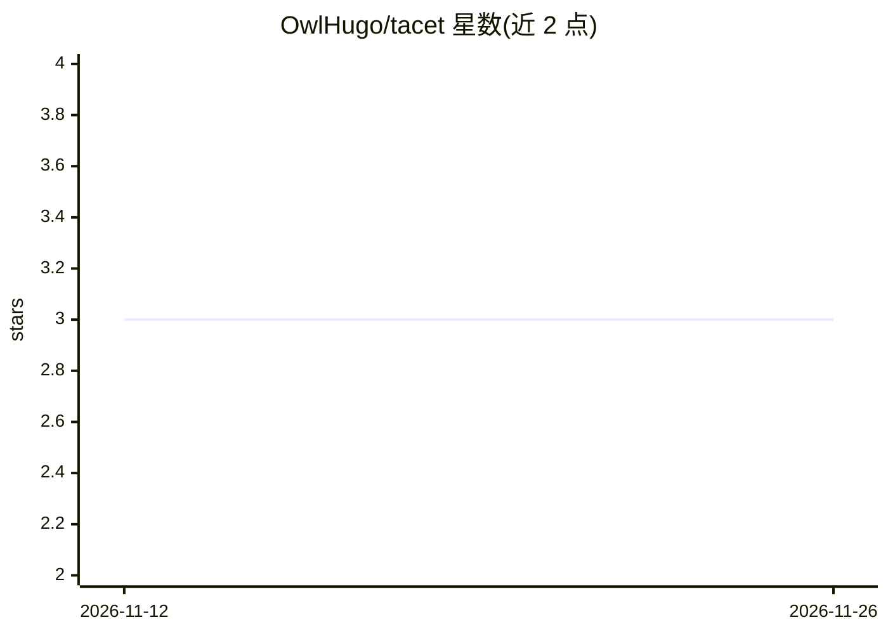

# OwlHugo/tacet

⭐ 3 · TypeScript · MIT · 推送 2026-11-03 · [GitHub](https://github.com/OwlHugo/tacet) · [官网](https://hugo.noctratech.com.br/projetos) · 个人维护

**本地会议转录与纪要工具：数据不出本机，纪要引用逐行出处**

Tacet 录制麦克风与系统通话音频两条轨道，用 whisper.cpp 转录，用本地 Ollama 模型生成纪要，全程数据留在本机（仅一次性从 Hugging Face 下载模型权重）。核心机制是 grounded minutes：每条决策与任务须引用转写行 id 并逐字核对，确定性检查丢弃引用不在转写中的条目。提供 macOS Apple Silicon 桌面应用（menu bar）与跨平台 CLI，需 Node 22.18+；Windows/Linux 桌面包已配置但未发布。无 Ollama 时仍保存转写、仅缺纪要。

## 筛选速览

| 维度 | 判定 | 备注 |
|---|---|---|
| AI 角色 | `ai-native` | 本体是模型或模型工具 |
| 许可风险 | `permissive` | MIT |
| 部署形态 | `desktop` | 安装包/桌面程序 |
| 模型依赖 | local-ok | 支持本地模型 |
| 硬件要求 | — | 无带数字的原话,不猜 |
| 安装摩擦 | `medium` | 含编译或系统依赖之一 |
| 成熟度 | — | 结构信号不足 |

## 能力要点

- 麦克风与系统音频双轨录制分离说话人，无需虚拟声卡驱动
- 每条决策/任务引用转写行 id，确定性检查拒绝编造条目（eval 中 106/106 拒绝注入的伪造项）
- 本地化路径：whisper.cpp 转录 + Ollama 生成，拒绝非 loopback 的 Ollama 主机
- 输出 Obsidian 兼容 Markdown，带 block id 行内链接与全局搜索

## 适用场景

- NDA、医疗、法律、HR 等不能把会议内容上传云端的场景
- 会议后生成带负责人与期限、且可跳转到原始发言的任务清单
- 导入已有录音文件跑同一转录与纪要流水线

## 场景标签

`语音识别` · 领域:感知与多模态

## 证据(README 行号)

> L4:  Records your mic and the call audio, transcribes with whisper.cpp, writes the minutes with a local LLM.
> L75: - Minutes are written by Ollama on `localhost`. The core refuses any Ollama host that is not loopback (`127.0.0.1`,
> L93: - **Grounded minutes.** Summary, decisions and action items with owners and deadlines. Every item cites transcript 

## 星数曲线

2026-11-12 3 → 2026-11-26 3（+0）

---
*卡片 v1 · prompt 1.4 · 生成 2026-11-22 · 置信度 high · 依据 README sha `75cd3350dbf2` · [字段定义](../../DATASET.md)*
