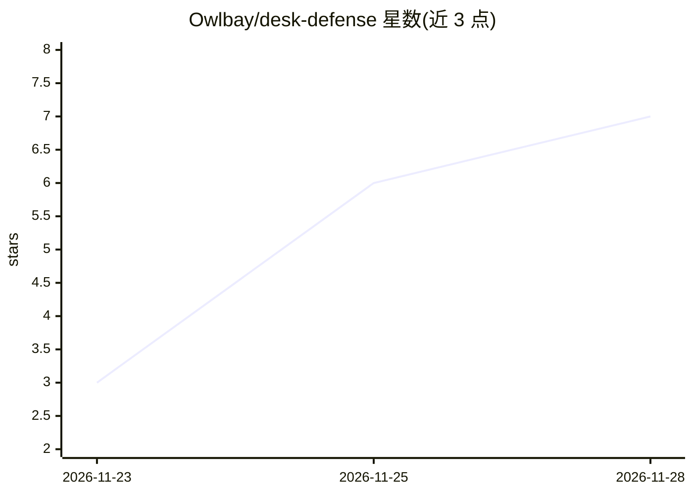

# Owlbay/desk-defense

⭐ 7 · TypeScript · MIT · 推送 2026-11-27 · [GitHub](https://github.com/Owlbay/desk-defense) · [官网](https://jjjj.games) · 个人维护 · 中文 README

**用文具摆迷宫的塔防游戏，支持大模型代玩或对战**

一款以书桌为棋盘、文具为塔的迷宫式塔防游戏，基于 TypeScript 与 Phaser 3，浏览器即开即玩，可装为 PWA 或打包成 iOS/Android/桌面应用（Capacitor/Tauri）。包含 3 种模式、12 座塔、16 种敌人、排行榜与回放。AI 部分：四种参战玩法（AI 玩家/军师/出题/对战），模型可来自多家托管 API、OpenAI 兼容中转或本机 Ollama/LM Studio，另提供 agent:play 无头命令行与 MCP 服务供 Claude Code 等客户端接入；API Key 仅存浏览器内存。部署需 Node.js 22.22+，排行榜功能依赖 Cloudflare Pages Functions + D1。

## 筛选速览

| 维度 | 判定 | 备注 |
|---|---|---|
| AI 角色 | `ai-enhanced` | 去掉 AI 部分产品仍成立 |
| 许可风险 | `permissive` | MIT |
| 部署形态 | `library` | 以包/库形式分发 |
| 模型依赖 | local-ok | 支持本地模型 |
| 硬件要求 | — | 无带数字的原话,不猜 |
| 安装摩擦 | `low` | 无编译、无系统依赖或容器化 |
| 成熟度 | — | 结构信号不足 |

## 能力要点

- 四种 AI 玩法：AI 玩家、AI 军师、AI 出题、双模型对战
- 支持托管 API、OpenAI 兼容中转与本机 Ollama/LM Studio 多种模型来源
- agent:play 无头运行与 MCP 服务，Claude Code 等客户端可直接当玩家
- 核心逻辑完全确定性，成绩带指令日志可回放复现

## 适用场景

- 在浏览器或手机上玩摆迷宫式塔防
- 让大模型全程操作或给我出主意打塔防
- 用 agent:eval 对比不同模型在同一批种子下的表现
- 用 MCP 让 Claude Code 客户端作为玩家接入游戏

## 场景标签

 · 领域:游戏/AI 玩法

## 证据(README 行号)

> L19: 书桌防线是一款迷宫式塔防游戏。棋盘是一张 12×14 的书桌，铅笔、订书机、台灯、圆规这些文具就是塔；每座塔（包括墙）都会挡路，所以怎么摆塔，就是怎么修迷宫。
> L48: - **模型来源**：Claude、OpenAI、Gemini、DeepSeek 等托管 API，OpenAI 兼容的中转服务，本机的 Ollama / LM Studio，或者不需要 Key 的离线演示。

## 星数曲线

2026-11-23 3 → 2026-11-28 7（+4）

---
*卡片 v1 · prompt 1.4 · 生成 2026-11-23 · 置信度 high · 依据 README sha `68687472fe46` · [字段定义](../../DATASET.md)*
