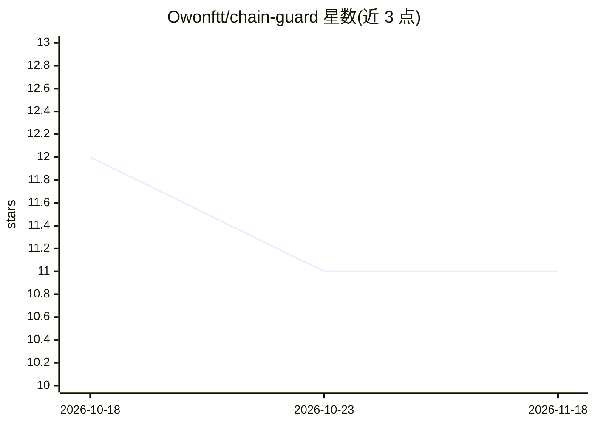

# Owonftt/chain-guard

⭐ 11 · Python · MIT · 推送 2026-05-23 · [GitHub](https://github.com/Owonftt/chain-guard) · 个人维护

**用四个 AI Agent 为 Solidity/Vyper 合约做安全审计**

ChainGuard 是一个智能合约安全审计平台，后端为 Python 3.10+ / FastAPI，前端为无构建步骤的原生 HTML/CSS/JS 仪表盘。它并行部署漏洞扫描、风险评分、Gas 分析、审计报告四个 Agent，分别产出 CWE/SWC 分类漏洞、0–100 风险评分、Gas 优化建议和汇总报告。LLM 依赖为 Xiaomi MiMo（7B-RL），经 OpenAI 兼容 API 调用；未配置 API key 时回退到内置启发式分析。安装方式为 git clone 后 pip 安装依赖，并用 uvicorn 启动服务。

## 筛选速览

| 维度 | 判定 | 备注 |
|---|---|---|
| AI 角色 | `ai-native` | 本体是模型或模型工具 |
| 许可风险 | `permissive` | MIT |
| 部署形态 | `library` | 以包/库形式分发 |
| 模型依赖 | — | README 未给出锁定关系 |
| 硬件要求 | — | 无带数字的原话,不猜 |
| 安装摩擦 | `low` | 无编译、无系统依赖或容器化 |
| 成熟度 | — | 结构信号不足 |

## 能力要点

- 四个并行 Agent：漏洞扫描、风险评分、Gas 分析、审计报告
- 支持 Solidity 与 Vyper 合约，按 CWE/SWC 分类输出漏洞
- 无 API key 时回退内置启发式分析
- 提供 /audit/contract 等 REST API 与暗色主题仪表盘

## 适用场景

- 在部署前扫描 Solidity/Vyper 合约的重入、溢出等漏洞
- 为合约生成 0–100 风险评分与分类解释
- 获取 Gas 优化建议与预估节省额度
- 生成带优先级建议的审计报告

## 场景标签

`多智能体` `网络安全` · 领域:Agent 开发

## 证据(README 行号)

> L10: > **AI-powered smart contract security auditing platform** — multi-agent vulnerability scanning, risk scoring, gas 
> L12: ChainGuard deploys four specialised AI agents that work in parallel to deliver comprehensive security audits for So

## 星数曲线

2026-10-18 12 → 2026-11-18 11（-1）

---
*卡片 v1 · prompt 1.4 · 生成 2026-11-18 · 置信度 high · 依据 README sha `8c2727b0b4f4` · [字段定义](../../DATASET.md)*
