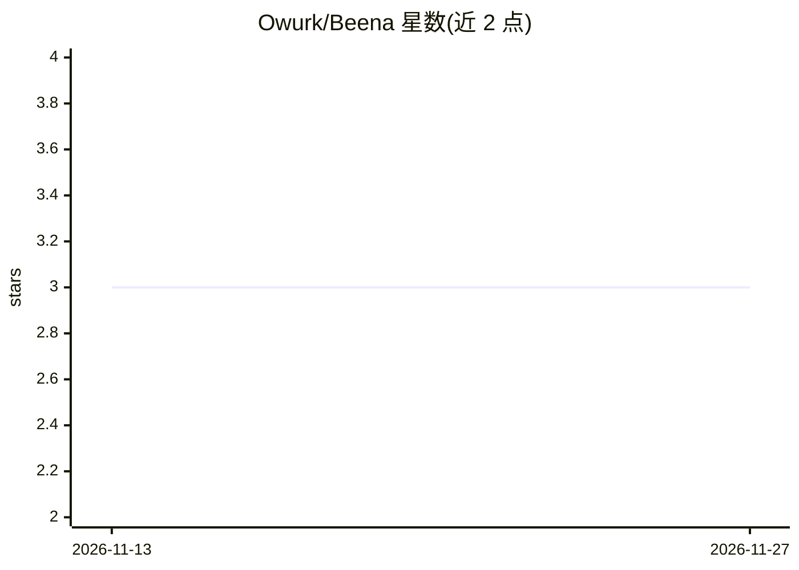

# Owurk/Beena

⭐ 3 · Python · 推送 2026-11-25 · [GitHub](https://github.com/Owurk/Beena) · [官网](https://beena.vahedclassifyui.ir) · 个人维护

**自托管家庭安防守护：本地检测+AI 场景描述+Telegram 告警**

Beena 是自托管的摄像头安防系统：OpenCV 运动检测（MOG2 背景减除、双帧确认）与本地 YOLO26 nano（ONNX Runtime CPU）目标检测过滤画面，确认人/动物后保存标注快照，经 Rust/Axum 核心转发给 FastAPI/LangChain AI 服务，由视觉语言模型生成 schema 校验的结构化场景描述（标题、描述、严重级、is_unusual），并通过 teloxide 机器人推送到 Telegram。四个独立进程经 localhost HTTP 与共享文件夹通信。运动与目标检测全本地，仅事件快照发送到用户配置的端点；需 Python 3.11+、Rust 工具链、OpenAI 兼容 API key 与 Telegram bot token；v1.0 仅支持 USB 摄像头/视频文件，RTSP 在 roadmap。

## 筛选速览

| 维度 | 判定 | 备注 |
|---|---|---|
| AI 角色 | `ai-native` | 本体是模型或模型工具 |
| 许可风险 | `none` | — |
| 部署形态 | `self-host` | docker 或自建部署 |
| 模型依赖 | local-ok | 支持本地模型 |
| 硬件要求 | — | 无带数字的原话,不猜 |
| 安装摩擦 | `low` | 无编译、无系统依赖或容器化 |
| 成熟度 | — | 结构信号不足 |

## 能力要点

- 本地 MOG2 运动检测与 YOLO26 nano 目标检测（COCO 80 类中保留 11 类），视频不出本机
- 视觉语言模型输出 schema 强制的结构化分析（标题/描述/severity/is_unusual）
- Rust/Axum 核心与 teloxide 机器人实现事件 intake 与秒级 Telegram 告警
- 隐私机制：图像路径双重校验、仅绑定 127.0.0.1、场景内指令被忽略

## 适用场景

- 在家用摄像头上检测人/动物并接收带 AI 描述的 Telegram 告警
- 用视频文件测试整条检测-分析-通知流水线
- 要求检测本地运行、仅事件快照上传的隐私优先安防部署

## 场景标签

`目标检测` · 领域:感知与多模态

## 证据(README 行号)

> L14: Beena watches a camera feed the way a guard would, not the way a recorder does. It detects motion, confirms that a 
> L23: - **AI scene analysis.** Every event is analyzed by a vision-language model that returns a schema-enforced result: 
> L45: |Vision pipeline|`python main.py`|Python, OpenCV, ONNX Runtime|-|camera input, motion, YOLO, snapshots|
> L46: |AI service|`python ai.py`|Python, FastAPI, LangChain|`127.0.0.1:8001`|visual analysis of each event|

## 星数曲线

2026-11-13 3 → 2026-11-27 3（+0）

---
*卡片 v1 · prompt 1.4 · 生成 2026-11-22 · 置信度 mid · 依据 README sha `92e4f57f2660` · [字段定义](../../DATASET.md)*
