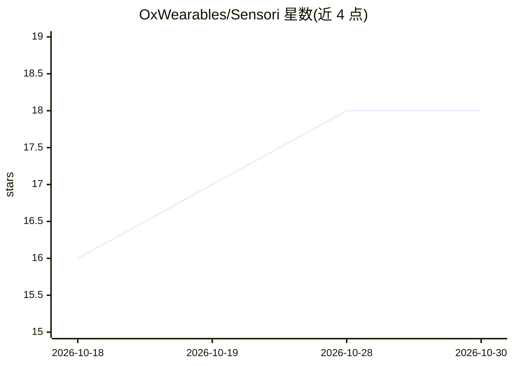

# OxWearables/Sensori

⭐ 18 · Jupyter Notebook · NOASSERTION · 推送 2026-09-01 · [GitHub](https://github.com/OxWearables/Sensori) · [官网](https://oxwearables.github.io/Sensori/) · 组织维护

**从24小时腕部加速度数据学习健康表征的自监督基础模型**

Sensori 是一个自监督基础模型，直接从连续 24 小时三轴腕部加速度原始数据学习健康与疾病的通用表征。仓库提供三类工具：在未标注加速度数据上预训练、用预训练权重提取日级健康表征、在下游健康与活动任务上评测冻结表征。预处理管线支持 CWA、GT3X、BIN 与带时间戳的 CSV 格式，读取原始设备文件需 Java 8 及以上；模型输入要求 10 Hz、单位为 g 的 float32 数据，并通过重力校准、低通滤波、非佩戴检测等质量控制。附带 NHANES 与 HAR 的可运行教程笔记本。

## 筛选速览

| 维度 | 判定 | 备注 |
|---|---|---|
| AI 角色 | `ai-native` | 本体是模型或模型工具 |
| 许可风险 | `none` | NOASSERTION |
| 部署形态 | `library` | 以包/库形式分发 |
| 模型依赖 | — | README 未给出锁定关系 |
| 硬件要求 | — | 无带数字的原话,不猜 |
| 安装摩擦 | `medium` | 含编译或系统依赖之一 |
| 成熟度 | — | 结构信号不足 |

## 能力要点

- 从 24 小时原始三轴腕部加速度自监督学习通用健康表征
- 支持 CWA/GT3X/BIN/CSV 常见腕部加速度计格式的预处理管线
- 预训练权重托管于 Hugging Face，一条命令提取日级嵌入
- 提供 NHANES 预处理与 HAR/健康下游评测三个教程笔记本

## 适用场景

- 用腕部加速度计数据提取日级健康表征用于下游研究
- 在自己的未标注加速度数据集上预训练 Sensori
- 在 NHANES 等公共数据上评测冻结表征的健康预测能力

## 场景标签

`模型训练` `模型评测` `教程课程` · 领域:评测与运维

## 证据(README 行号)

> L7: Sensori is a self-supervised foundation model that learns general-purpose
> L14: - Extract day-level health representations using pretrained Sensori weights.

## 星数曲线

2026-10-18 16 → 2026-10-30 18（+2）

---
*卡片 v1 · prompt 1.4 · 生成 2026-10-29 · 置信度 mid · 依据 README sha `349420adc9d5` · [字段定义](../../DATASET.md)*
