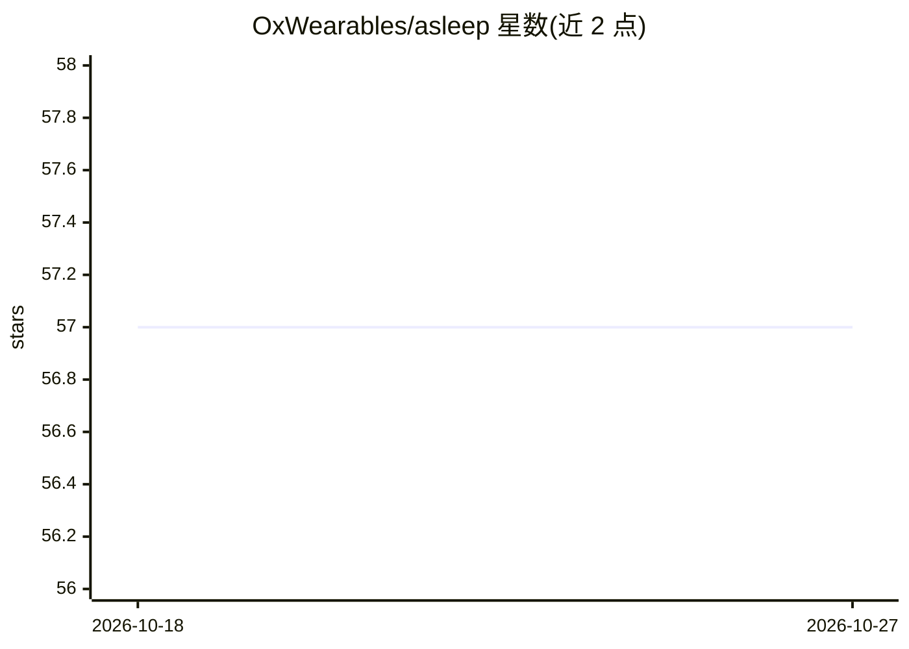

# OxWearables/asleep

⭐ 57 · Python · NOASSERTION · 推送 2026-10-09 · [GitHub](https://github.com/OxWearables/asleep) · 组织维护

**用深度学习从腕部加速度计数据分类睡眠阶段的 Python 包**

Python 包，读取腕戴式三轴加速度计数据（AX3 .cwa 文件或含 time,x,y,z 表头的 CSV），运行机器学习模型输出睡眠阶段分类及睡眠指标：总睡眠时长、睡眠效率、REM/NREM 时长等，并附带可视化命令。底层模型在 1000+ 夜多中心多导睡眠监测与三轴加速度计数据上训练测试；首次使用时需下载模型权重。要求 Python 3.8 与 Java 8 及以上。提供 get_sleep、visu_sleep 命令行接口，附有可引用论文。

## 筛选速览

| 维度 | 判定 | 备注 |
|---|---|---|
| AI 角色 | `ai-native` | 本体是模型或模型工具 |
| 许可风险 | `none` | NOASSERTION |
| 部署形态 | `library` | 以包/库形式分发 |
| 模型依赖 | — | README 未给出锁定关系 |
| 硬件要求 | — | 无带数字的原话,不猜 |
| 安装摩擦 | `medium` | 含编译或系统依赖之一 |
| 成熟度 | — | 结构信号不足 |

## 能力要点

- 从腕部加速度计数据分类睡眠阶段
- 输出总睡眠时长、睡眠效率、REM/NREM 等睡眠结构指标
- 模型在 1000+ 夜多中心多导睡眠监测数据上训练测试
- 支持 AX3 .cwa 文件与 time,x,y,z 表头的 CSV 输入

## 适用场景

- 处理腕戴加速度计数据获得睡眠阶段与睡眠指标
- 人群健康研究中批量估算睡眠时长与睡眠效率
- 对已有输出结果做睡眠参数可视化

## 场景标签

 · 领域:健康/可穿戴传感数据分析

## 证据(README 行号)

> L2: This is a Python package for classifying sleep stages from wearable sensor data / wrist - worn accelerometer. The un
> L3: was trained and tested in 1000 + nights of multi - centre polysomnography with tri - axial accelerometer data.

## 星数曲线

2026-10-18 57 → 2026-10-27 57（+0）

---
*卡片 v1 · prompt 1.4 · 生成 2026-10-24 · 置信度 high · 依据 README sha `5cac04976426` · [字段定义](../../DATASET.md)*
