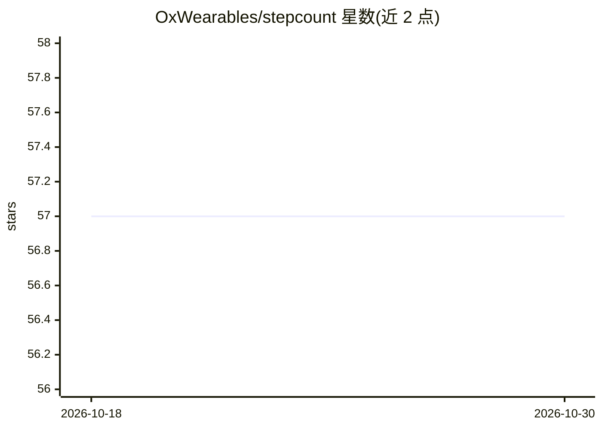

# OxWearables/stepcount

⭐ 57 · Jupyter Notebook · NOASSERTION · 推送 2026-10-09 · [GitHub](https://github.com/OxWearables/stepcount) · 组织维护

**基于基础模型的手腕加速度计计步命令行工具**

OxWearables 出品的计步 CLI 工具：使用在英国生物银行大规模加速度数据集上自监督预训练、OxWalk 数据集微调的 ResNet18 基础模型检测行走时段并输出计步结果；也可切换到随机森林模型（-t rf）。直接处理 Axivity AX3 文件（英国/中国嘉道理生物银行格式），消费级设备数据需先转为含 time/x/y/z 列的 CSV。输出分钟/小时/日级步数、ENMO、行走 bout 与图表，支持缺失数据填补和批量处理汇总。需 Python 3.8-3.10 与 Java 8。

## 筛选速览

| 维度 | 判定 | 备注 |
|---|---|---|
| AI 角色 | `ai-native` | 本体是模型或模型工具 |
| 许可风险 | `none` | NOASSERTION |
| 部署形态 | `library` | 以包/库形式分发 |
| 模型依赖 | — | README 未给出锁定关系 |
| 硬件要求 | — | 无带数字的原话,不猜 |
| 安装摩擦 | `medium` | 含编译或系统依赖之一 |
| 成熟度 | — | 结构信号不足 |

## 能力要点

- 自监督 Resnet18 基础模型检测行走时段（可切换随机森林）
- 直接读取 Axivity AX3 文件，支持自定义列名 CSV
- 输出分钟/小时/日级步数、ENMO、行走 bout 与每日图表
- 提供缺失数据 time-of-day 填补与多文件批量处理/汇总脚本

## 适用场景

- 处理 UK Biobank / 中国嘉道理生物银行的 AX3 加速度数据并计步
- 研究可穿戴设备步数与身体活动指标（ENMO、步频峰值等）
- 将 Fitbit/Apple Watch 数据转为 CSV 后统一计步分析

## 场景标签

 · 领域:健康/可穿戴计算

## 证据(README 行号)

> L6: Improved step counting based on a foundation model for wrist-worn accelerometers.
> L8: The foundation model was trained using self-supervised learning on the large-scale UK Biobank Accelerometer Dataset,
> L92: By default, the `stepcount` tool employs a self-supervised Resnet18 model to detect walking periods.

## 星数曲线

2026-10-18 57 → 2026-10-30 57（+0）

---
*卡片 v1 · prompt 1.4 · 生成 2026-10-24 · 置信度 high · 依据 README sha `66cf66c100cf` · [字段定义](../../DATASET.md)*
