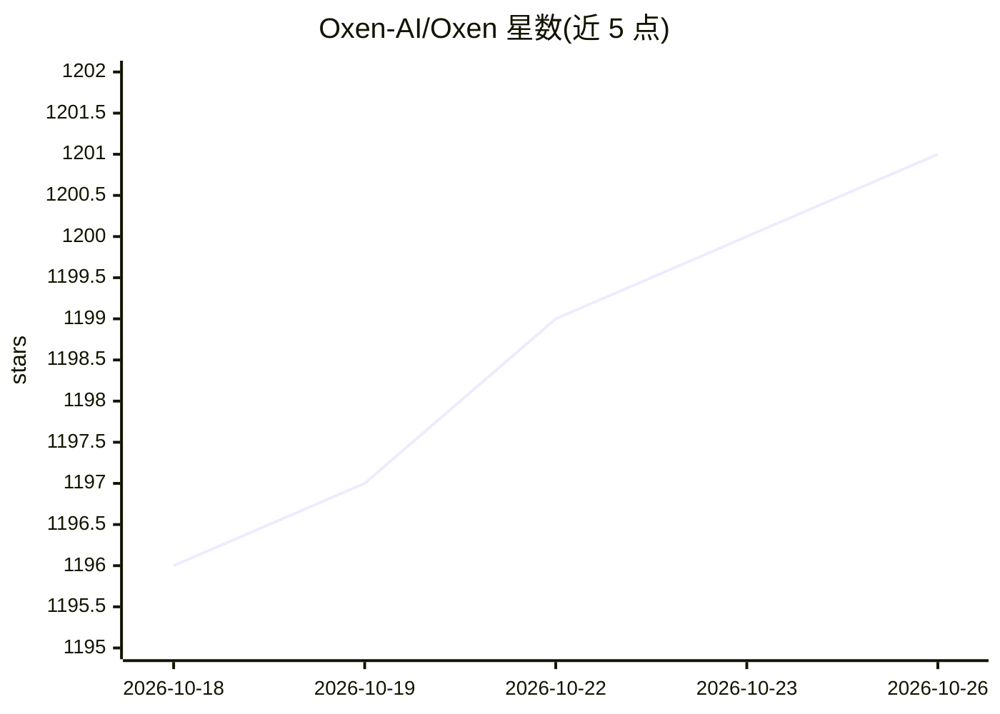

# Oxen-AI/Oxen

⭐ 1,201 · Rust · Apache-2.0 · 推送 2026-10-25 · [GitHub](https://github.com/Oxen-AI/Oxen) · [官网](https://oxen.ai) · 组织维护

**面向机器学习数据集的高速数据版本控制系统**

用 Rust 编写的数据版本控制系统，命令接口模仿 git，面向包含数百万文件、TB 级数据的大型仓库，支持图片、音视频、文本、parquet/csv/jsonl 等格式，并对表格数据提供索引与查询。使用方式包括 oxen CLI、oxenai Python 包、HTTP API，可托管在 OxenHub 或自托管 oxen-server，也可嵌入 liboxen crate。CLI 与 Python 包支持 Linux/macOS/Windows，oxen-server 不支持 Windows（可用 Docker）。

## 筛选速览

| 维度 | 判定 | 备注 |
|---|---|---|
| AI 角色 | `ai-ecosystem` | LLM/agent 周边工具 |
| 许可风险 | `permissive` | Apache-2.0 |
| 部署形态 | `desktop` | 安装包/桌面程序 |
| 模型依赖 | — | README 未给出锁定关系 |
| 硬件要求 | — | 无带数字的原话,不猜 |
| 安装摩擦 | `medium` | 含编译或系统依赖之一 |
| 成熟度 | — | 结构信号不足 |

## 能力要点

- git 式命令接口，面向百万级文件与 TB 级数据仓库
- 原生表格数据处理（索引与查询 csv/parquet/jsonl）
- 支持 CLI、Python 包、HTTP API 与自托管 oxen-server
- 通过 merkle tree 缓存文件元数据以加速访问

## 适用场景

- 对机器学习训练数据集做版本管理与变更追踪
- 团队协作同步大型图片/视频/标注数据仓库
- 查询与可视化 csv/parquet 等表格数据的版本历史

## 场景标签

`MLOps` · 领域:训练与推理

## 证据(README 行号)

> L27: Oxen is a lightning fast data version control system for large datasets. We aim to make versioning data as easy as 
> L29: The interface mirrors git, but shines where git and git-lfs fall short. Oxen is built from the ground up for any da

## 星数曲线

2026-10-18 1,196 → 2026-10-26 1,201（+5）

---
*卡片 v1 · prompt 1.4 · 生成 2026-10-21 · 置信度 high · 依据 README sha `284c9f2b6e06` · [字段定义](../../DATASET.md)*
