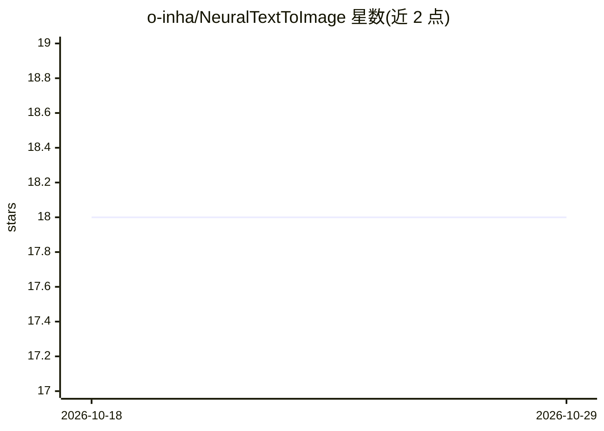

# o-inha/NeuralTextToImage

⭐ 18 · Jupyter Notebook · 推送 2026-09-25 · [GitHub](https://github.com/o-inha/NeuralTextToImage) · 个人维护

**多种文生图模型的 Colab notebook 合集，提示词驱动图像生成**

提供多个可在 Google Colab 中打开的 text-to-image 生成 notebook，覆盖 Stable Diffusion（v1.4/v1.5/waifu diffusion）、DALL·E Mini、Latent Diffusion LAION 400M、ruDALLE Malevich、JAX CLIP Guided Diffusion、CLIP+VQGAN、Latent Vision、Big Sleep 等。部分 notebook 需注册 Hugging Face token 或 wandb 认证 key 下载模型。仓库自 2022 年起停止维护，作者不定期使用，库更新后 notebook 可能失效。

## 筛选速览

| 维度 | 判定 | 备注 |
|---|---|---|
| AI 角色 | `ai-knowledge` | 知识聚合/清单类 |
| 许可风险 | `none` | — |
| 部署形态 | `None` |  |
| 模型依赖 | — | README 未给出锁定关系 |
| 硬件要求 | — | 无带数字的原话,不猜 |
| 安装摩擦 | `low` | 无编译、无系统依赖或容器化 |
| 成熟度 | — | 结构信号不足 |

## 能力要点

- 8 类文生图 notebook，从 Stable Diffusion 到 Big Sleep
- 提供 Open In Colab 一键打开入口
- 各 notebook 附论文出处（VQGAN/CLIP/BigGAN 等）与生成示例图

## 适用场景

- 在 Colab 中直接尝试各类文本生成图像模型
- 对比 CLIP 引导的不同文生图方法（Big Sleep、CLIP+VQGAN 等）
- 了解 2021-2022 年文生图技术谱系与原始论文出处

## 场景标签

`图像生成` · 领域:内容生成

## 证据(README 行号)

> L1: # Colab notebooks for text-to-image generators
> L5: User-friendly Colab notebooks for various text prompt steered synthetic image generators. These notebooks are not ac
> L9: - Stable Diffusion (v1.4, v1.5, waifu diffusion)

## 星数曲线

2026-10-18 18 → 2026-10-29 18（+0）

---
*卡片 v1 · prompt 1.4 · 生成 2026-10-29 · 置信度 high · 依据 README sha `2b00ff4e2eb9` · [字段定义](../../DATASET.md)*
