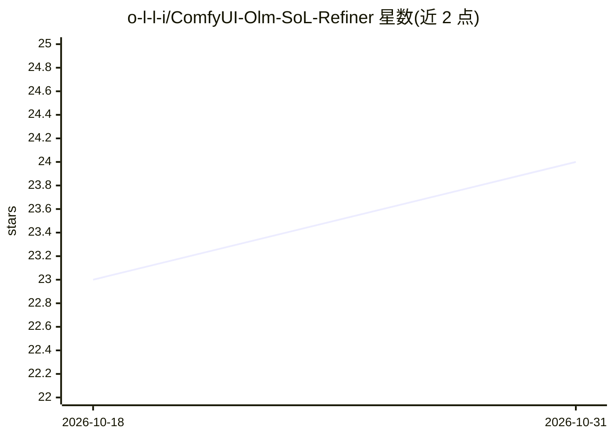

# o-l-l-i/ComfyUI-Olm-SoL-Refiner

⭐ 24 · Python · NOASSERTION · 推送 2026-09-30 · [GitHub](https://github.com/o-l-l-i/ComfyUI-Olm-SoL-Refiner) · 个人维护

**在 ComfyUI 中运行 NVIDIA SoL Refiner 的视频精修放大节点**

ComfyUI 自定义节点集，封装 NVIDIA SoL Refiner（LTX-2.5 MiniMax-H3 检查点）的加载与视频生成式精修/放大：读取解码帧与文本提示，按选定输出尺寸重绘并保留帧数、FPS 与原音频。作者声明为实验性质，生成式精修可能改变面部、服饰等细节。需本地准备约 71 GB 模型权重；仅在 Windows、ComfyUI 0.31.0、PyTorch 2.13/CUDA 13、RTX 5090（32 GB VRAM、128 GB RAM）环境测试，其他 GPU 与系统未验证。

## 筛选速览

| 维度 | 判定 | 备注 |
|---|---|---|
| AI 角色 | `ai-ecosystem` | LLM/agent 周边工具 |
| 许可风险 | `none` | NOASSERTION |
| 部署形态 | `library` | 以包/库形式分发 |
| 模型依赖 | — | README 未给出锁定关系 |
| 硬件要求 | `gpu-24g` | |
| 安装摩擦 | `medium` | 含编译或系统依赖之一 |
| 成熟度 | `idea` | |

## 能力要点

- SoL Refiner 加载器与视频精修节点，支持 fp8/bf16/nvfp4 精度
- 仅加载本地文件，不修改权重、不额外下载模型
- 使用 ComfyUI 内存管理，分阶段卸载（不支持 --novram）
- 模型权重约 71 GB，不随代码分发

## 适用场景

- 在 ComfyUI 工作流中对视频做生成式精修与放大
- 用文本提示控制视频细节重绘并保留原音频与 FPS
- 通过 extra_model_paths.yaml 复用已有 diffusers 模型目录

## 场景标签

`视频生成` · 领域:内容生成

## 证据(README 行号)

> L3: Experimental ComfyUI nodes for NVIDIA's
> L10: SoL Refiner loader and video refinement nodes in ComfyUI
> L62: The nodes load local files only and do not modify the weights or download

## 星数曲线

2026-10-18 23 → 2026-10-31 24（+1）

---
*卡片 v1 · prompt 1.4 · 生成 2026-10-27 · 置信度 mid · 依据 README sha `dd6af87f110a` · [字段定义](../../DATASET.md)*
