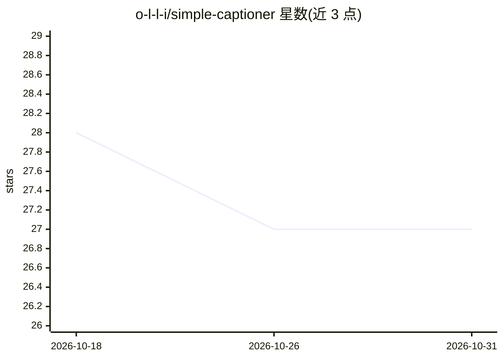

# o-l-l-i/simple-captioner

⭐ 27 · Python · NOASSERTION · 推送 2026-04-01 · [GitHub](https://github.com/o-l-l-i/simple-captioner) · 个人维护

**批量给图片和视频生成描述文本的 Gradio 应用**

基于 Qwen2.5/3 VL 与 Qwen3.5 系列视觉语言模型的本地媒体标注工具，通过 Gradio UI 选择文件夹批量处理图片和视频，为每个媒体文件生成同名的 txt 描述文件；支持子文件夹扫描、跳过已标注文件、提示词自定义、Summary/One-Sentence 两种风格、Flash Attention 2 与 BitsAndBytes 8/4-bit 量化。需 NVIDIA CUDA GPU（建议约 16GB VRAM），模型从 Hugging Face 自动下载缓存。从源码安装运行，README 声明项目处于早期开发阶段。

## 筛选速览

| 维度 | 判定 | 备注 |
|---|---|---|
| AI 角色 | `ai-native` | 本体是模型或模型工具 |
| 许可风险 | `none` | NOASSERTION |
| 部署形态 | `library` | 以包/库形式分发 |
| 模型依赖 | — | README 未给出锁定关系 |
| 硬件要求 | `gpu-8g` | |
| 安装摩擦 | `medium` | 含编译或系统依赖之一 |
| 成熟度 | `idea` | |

## 能力要点

- 支持 Qwen2.5-VL/3-VL/3.5 共 6 个模型可选，带模型下拉切换
- 图片与视频批量标注，输出同名 txt 文件，支持子文件夹与跳过已标注
- Flash Attention 2 开关与 BitsAndBytes 8/4-bit 量化，可调整 max_tokens 控制 VRAM 占用

## 适用场景

- 为训练数据集批量生成图片/视频的文本描述（打标）
- 本地对媒体文件夹递归扫描并生成描述文件
- 通过提示词与句长约束调整描述风格

## 场景标签

`多模态` · 领域:感知与多模态

## 证据(README 行号)

> L3: A minimal media captioning tool powered by **Qwen2.5/3 VL Instruct and Qwen3.5 4B/9B** from Alibaba Group.
> L5: This tool uses a Gradio UI to batch process folders of **images and videos** and generate descriptive captions.

## 星数曲线

2026-10-18 28 → 2026-10-31 27（-1）

---
*卡片 v1 · prompt 1.4 · 生成 2026-10-26 · 置信度 mid · 依据 README sha `7866686eaac0` · [字段定义](../../DATASET.md)*
