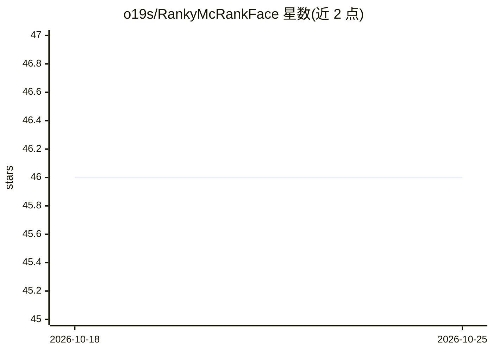

# o19s/RankyMcRankFace

⭐ 46 · Java · NOASSERTION · 推送 2026-10-23 · [GitHub](https://github.com/o19s/RankyMcRankFace) · 组织维护

**Ranklib 学习排序库的加固分支，便于接入 ES/OpenSearch LTR 插件**

OpenSource Connections 维护的 Ranklib 学习排序（learning to rank）库分支，以 Maven 构件发布于 com.o19s:RankyMcRankFace 命名空间。改动面向与 Elasticsearch Learning to Rank Plugin 及 OpenSearch Learning to Rank Plugin 的集成：提升模型读取性能，训练时输出各特征提升的误差削减量（impact）。原始 Ranklib 由 Lemur 项目在 SourceForge 托管。作为 Java 库供搜索相关开发者使用。

## 筛选速览

| 维度 | 判定 | 备注 |
|---|---|---|
| AI 角色 | `ai-native` | 本体是模型或模型工具 |
| 许可风险 | `none` | NOASSERTION |
| 部署形态 | `None` |  |
| 模型依赖 | — | README 未给出锁定关系 |
| 硬件要求 | — | 无带数字的原话,不猜 |
| 安装摩擦 | `low` | 无编译、无系统依赖或容器化 |
| 成熟度 | — | 结构信号不足 |

## 能力要点

- Ranklib 的 fork，发布于 Maven（com.o19s 命名空间）
- 面向 Elasticsearch / OpenSearch Learning to Rank Plugin 的集成改进
- 模型读取性能改进
- 训练时输出每个特征对总误差削减的影响

## 适用场景

- 在 Elasticsearch/OpenSearch LTR 插件中使用 Ranklib 训练的模型
- 分析各特征对排序模型误差的贡献

## 场景标签

`语义搜索` · 领域:知识与检索

## 证据(README 行号)

> L3: This project is OpenSource Connections API-compatible fork of Ranklib, deployed on Maven, with various improvements 

## 星数曲线

2026-10-18 46 → 2026-10-25 46（+0）

---
*卡片 v1 · prompt 1.4 · 生成 2026-10-25 · 置信度 high · 依据 README sha `eb9b8c77d156` · [字段定义](../../DATASET.md)*
