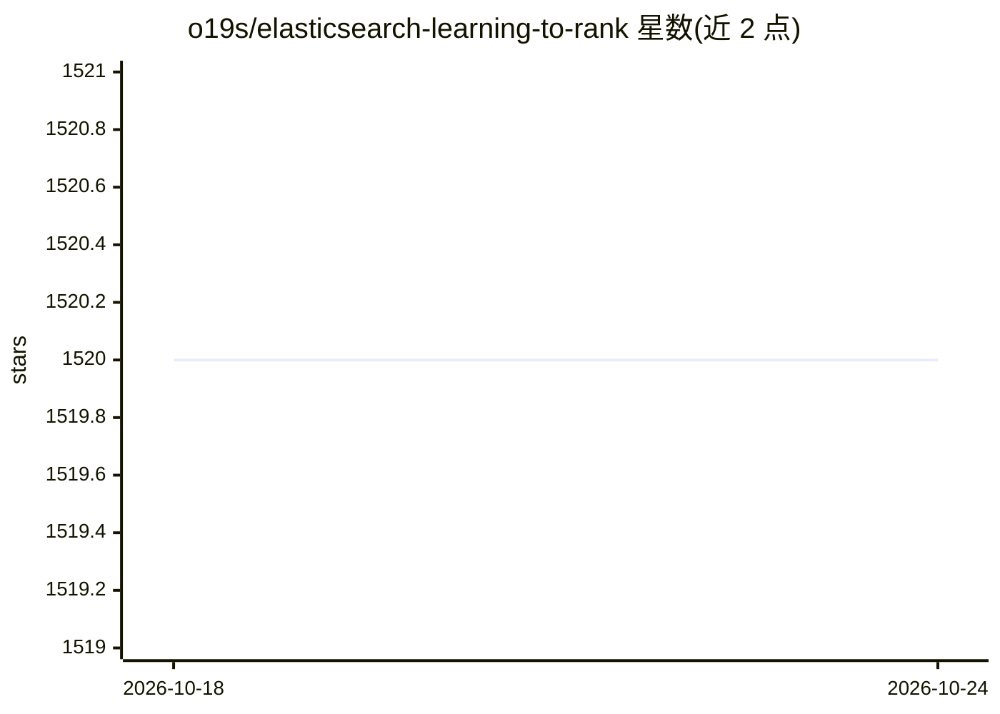

# o19s/elasticsearch-learning-to-rank

⭐ 1,520 · Java · Apache-2.0 · 推送 2026-06-16 · [GitHub](https://github.com/o19s/elasticsearch-learning-to-rank) · [官网](http://opensourceconnections.com/blog/2017/02/14/elasticsearch-learning-to-rank/) · 组织维护

**给搜索工程师的 Elasticsearch 插件：用机器学习模型重排搜索结果**

由 o19s 维护的 Elasticsearch 学习排序（LTR）插件：以 Elasticsearch 查询模板形式存储特征（features），记录特征分数生成离线模型训练集，存储 linear、XGBoost 或 RankLib 排序模型并在查询时用存储模型对搜索结果重排。面向构建搜索相关性的工程师，Wikimedia Foundation、Snagajob 等在生产使用。通过 elasticsearch-plugin 命令安装预构建 zip（需匹配 ES 版本并重启集群），无对应版本时可自行 Gradle 构建部署。

## 筛选速览

| 维度 | 判定 | 备注 |
|---|---|---|
| AI 角色 | `ai-ecosystem` | LLM/agent 周边工具 |
| 许可风险 | `permissive` | Apache-2.0 |
| 部署形态 | `desktop` | 安装包/桌面程序 |
| 模型依赖 | — | README 未给出锁定关系 |
| 硬件要求 | — | 无带数字的原话,不猜 |
| 安装摩擦 | `low` | 无编译、无系统依赖或容器化 |
| 成熟度 | — | 结构信号不足 |

## 能力要点

- 特征以 Elasticsearch 查询模板形式存储
- 记录特征分数生成训练数据集
- 支持存储 linear / XGBoost / RankLib 模型并对搜索结果重排
- 提供预构建版本 zip，按 Elasticsearch 版本匹配安装

## 适用场景

- 为电商/站内搜索接入学习排序提升相关性
- 采集特征分数日志用于离线训练排序模型
- 将已训练的 XGBoost/RankLib 模型部署到线上搜索

## 场景标签

 · 领域:搜索/信息检索

## 证据(README 行号)

> L9: - Allows you to store features (Elasticsearch query templates) in Elasticsearch
> L11: - Stores linear, xgboost, or ranklib ranking models in Elasticsearch that use features you've stored
> L12: - Ranks search results using a stored model

## 星数曲线

2026-10-18 1,520 → 2026-10-24 1,520（+0）

---
*卡片 v1 · prompt 1.4 · 生成 2026-10-21 · 置信度 high · 依据 README sha `5d10136b70ea` · [字段定义](../../DATASET.md)*
