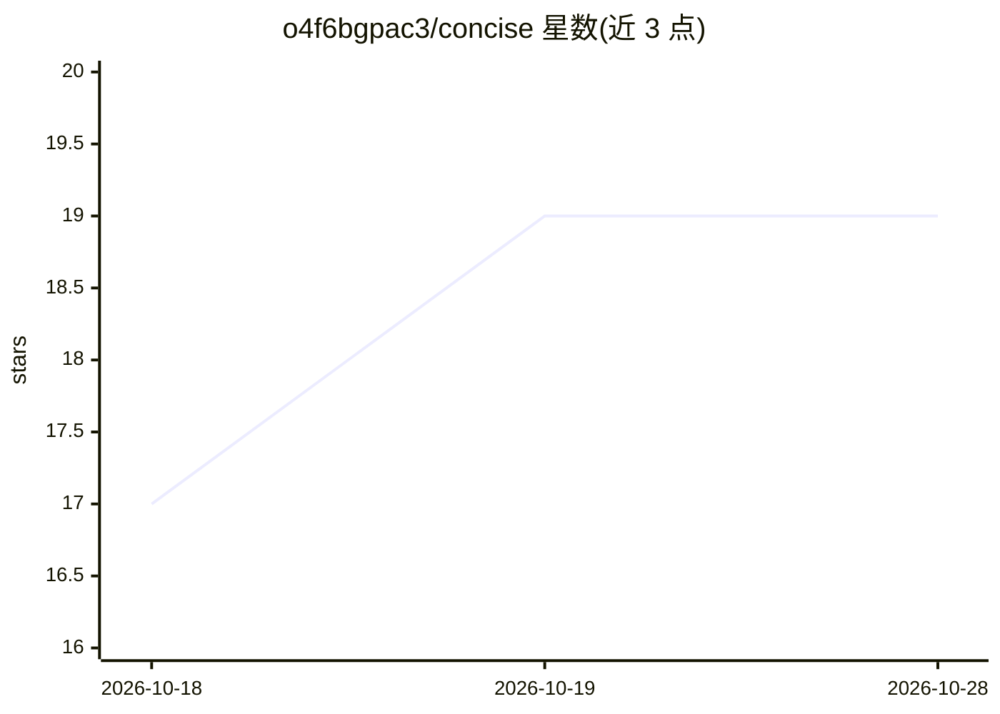

# o4f6bgpac3/concise

⭐ 19 · Shell · MIT · 推送 2026-04-08 · [GitHub](https://github.com/o4f6bgpac3/concise) · 个人维护

**让 Claude 等编程助手简洁回复的技能/插件，省约60-70%输出token**

面向 Claude Code 与 Codex 的技能/插件，兼用于 Cursor、Cline、Windsurf 和 GitHub Copilot。机制为通过提示词约束使模型回复压缩约 60-70% 输出 token，同时保持自然英语：删寒暄、含糊语和不必要冠词，代码块、技术术语与错误信息保持原样。支持随时要求展开细节，一次详细回答后自动恢复简洁模式。提供 npx skills 命令与 Claude Code 插件市场两种安装方式，MIT 许可。

## 筛选速览

| 维度 | 判定 | 备注 |
|---|---|---|
| AI 角色 | `ai-ecosystem` | LLM/agent 周边工具 |
| 许可风险 | `permissive` | MIT |
| 部署形态 | `library` | 以包/库形式分发 |
| 模型依赖 | — | README 未给出锁定关系 |
| 硬件要求 | — | 无带数字的原话,不猜 |
| 安装摩擦 | `low` | 无编译、无系统依赖或容器化 |
| 成熟度 | — | 结构信号不足 |

## 能力要点

- 以提示词技能压缩约 60-70% 输出 token，保留语法与技术信息
- 可随时请求展开详细回答，之后自动恢复简洁模式
- 支持 Claude Code、Codex、Cursor、Cline、Windsurf、GitHub Copilot 多种编程助手
- npx skills 与 Claude Code 插件市场两种安装途径

## 适用场景

- 降低日常使用 Claude Code 等 AI 编程助手的 API 开销
- 减少 AI 回复篇幅获得更快响应
- 需要简洁但语法完整的英文回答而非电报式压缩

## 场景标签

`提示工程` · 领域:Agent 开发

## 证据(README 行号)

> L14: A Claude Code skill/plugin and Codex plugin that makes Claude respond concisely -- cutting **~60-70% of output toke
> L62: npx skills add o4f6bgpac3/concise

## 星数曲线

2026-10-18 17 → 2026-10-28 19（+2）

---
*卡片 v1 · prompt 1.4 · 生成 2026-10-28 · 置信度 high · 依据 README sha `e88642167f11` · [字段定义](../../DATASET.md)*
