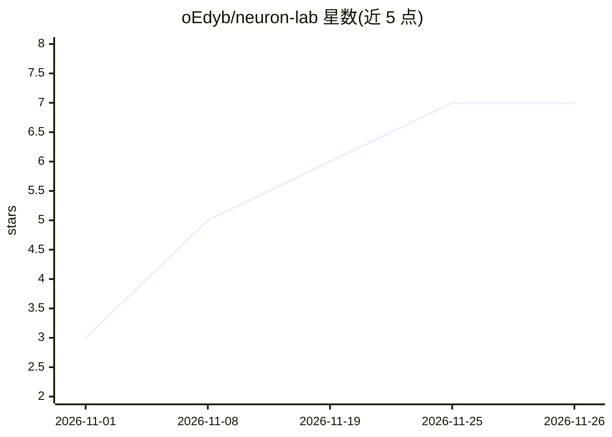

# oEdyb/neuron-lab

⭐ 7 · Python · MIT · 推送 2026-11-04 · [GitHub](https://github.com/oEdyb/neuron-lab) · 个人维护

**在开源权重 LLM 中定位、修改单个神经元并对话的工具**

面向 Qwen3.5、Gemma 4、Ministral 3 等开源权重模型的可解释性研究工具：通过可视化地图浏览各层神经元，用反向传播按句对（如 I hate you vs I like you）定位相关神经元，向指定神经元的 down_proj 列注入定向偏移并观察模型输出变化。提供 Web 界面（server.py）、命令行脚本（find/chat/doses/map）与 JSON API，支持按 dose 评分、批量对比与共享 Library。模型与地图首次启动时从 Hugging Face 下载，可用 NEURON_LAB_MAPS 指向本地地图。

## 筛选速览

| 维度 | 判定 | 备注 |
|---|---|---|
| AI 角色 | `ai-native` | 本体是模型或模型工具 |
| 许可风险 | `permissive` | MIT |
| 部署形态 | `None` |  |
| 模型依赖 | — | README 未给出锁定关系 |
| 硬件要求 | — | 无带数字的原话,不猜 |
| 安装摩擦 | `medium` | 含编译或系统依赖之一 |
| 成熟度 | — | 结构信号不足 |

## 能力要点

- 一次反向传播为所有神经元计算定向排名，前 20 名做实际偏移并与随机方向对照
- Web 界面浏览 24 层×6,144 神经元地图，同页对话，Batch/Combine 两种多神经元模式
- 保存层输出与单步线性注意力等加速使地图构建约提速 8 倍（L4 实测数据）
- 提供 JSON API 与 AGENTS.md，可让外部 agent 检索神经元并保存到 Library

## 适用场景

- 定位改变模型说话方式的单个神经元并调整其激活
- 研究特定 dose 下模型输出从连贯到循环的边界
- 为开源模型构建与共享神经元地图
- 通过 agent 自动检索并标注有趣神经元

## 场景标签

`科研工具` `聊天机器人` `模型评测` · 领域:对话与助手

## 证据(README 行号)

> L3: Find single neurons in open-weight models that change how the model talks. Change them and chat with the result. Wor
> L59: Ranks the neurons that make the model say your sentence instead of its opposite (`I hate you.` vs `I like you.`, sa

## 星数曲线

2026-11-01 3 → 2026-11-26 7（+4）

---
*卡片 v1 · prompt 1.4 · 生成 2026-11-20 · 置信度 high · 依据 README sha `416df8755ddc` · [字段定义](../../DATASET.md)*
