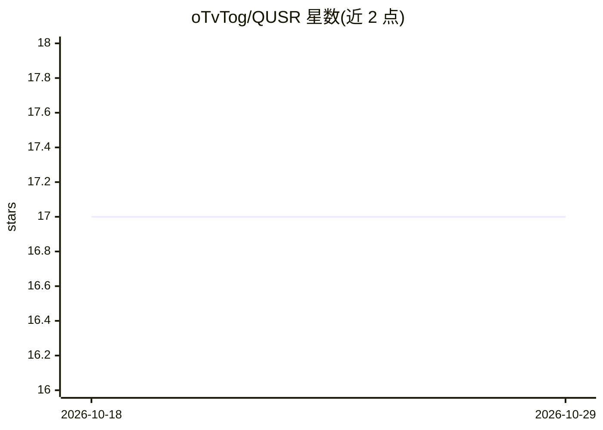

# oTvTog/QUSR

⭐ 17 · Python · 推送 2026-03-10 · [GitHub](https://github.com/oTvTog/QUSR) · 个人维护

**面向真实世界超分的质量感知不确定性引导扩散模型（ICASSP 2026）**

研究代码仓库：QUSR 基于 Stable Diffusion 2.1 Base 实现真实世界图像超分辨率，由 QAP（MLLM 生成的质量提示词）、UNG、UEM 三个模块构成；用 Qwen2.5-VL-7B 生成质量描述替代 RAM 模型，并支持不确定性引导选项。提供 RealSR/DRealSR 上 4× 超分的基准指标与预置测试集质量提示词，通过 git clone + conda + pip 安装，运行 test_qusr.py 推理、accelerate launch 训练。构建于 PiSA-SR 与 OSEDiff 之上，Apache 2.0 许可。

## 筛选速览

| 维度 | 判定 | 备注 |
|---|---|---|
| AI 角色 | `ai-native` | 本体是模型或模型工具 |
| 许可风险 | `none` | — |
| 部署形态 | `library` | 以包/库形式分发 |
| 模型依赖 | — | README 未给出锁定关系 |
| 硬件要求 | — | 无带数字的原话,不猜 |
| 安装摩擦 | `low` | 无编译、无系统依赖或容器化 |
| 成熟度 | — | 结构信号不足 |

## 能力要点

- QAP：以 MLLM（Qwen2.5-VL-7B）生成质量提示词替代 RAM 模型
- 不确定性引导（--enable_uncertainty）推理选项
- 预置 RealSR/DRealSR 测试集质量提示词，可直接运行推理
- 提供 PSNR/SSIM/LPIPS/DISTS 等基准测试结果与日志路径

## 适用场景

- 在 RealSR/DRealSR 数据集上运行 4× 真实世界超分推理
- 复现论文实验指标与可视化结果
- 基于自有数据训练 QUSR 超分模型

## 场景标签

`图像视频处理` · 领域:感知与多模态

## 证据(README 行号)

> L1: # QUSR: Quality-Aware Prior with Uncertainty-Guided Noise Generation for Real-World Super-Resolution
> L117: ├── qusr.py           # QUSR model (QAP, UNG, UEM)

## 星数曲线

2026-10-18 17 → 2026-10-29 17（+0）

---
*卡片 v1 · prompt 1.4 · 生成 2026-10-29 · 置信度 high · 依据 README sha `bb2e9daf508d` · [字段定义](../../DATASET.md)*
