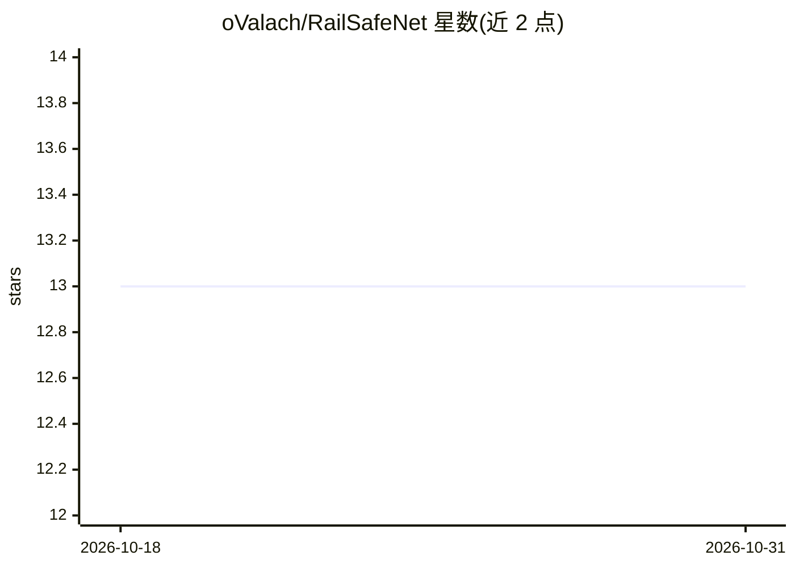

# oValach/RailSafeNet

⭐ 13 · Python · MIT · 推送 2026-02-08 · [GitHub](https://github.com/oValach/RailSafeNet) · [官网](https://huggingface.co/spaces/oValach/RailSafeNet-app) · 个人维护

**有轨电车安全视觉场景理解：铁轨分割与目标检测及距离估计**

配书用代码库，源自硕士论文及后续会议论文 RailSafeNet。流水线结合 SegFormerB3（铁轨分割）与 YOLOv8s（目标定位），结果经 The Distance Accessor 进一步处理以估计距离；使用 RailSem19 和 Pisel Railway 数据集微调，提供微调后权重（外部网盘）与可视化素材。通过 conda 环境安装，运行 TheDistanceAccessor.py 做单样本推理，另有 HuggingFace 演示。

## 筛选速览

| 维度 | 判定 | 备注 |
|---|---|---|
| AI 角色 | `ai-native` | 本体是模型或模型工具 |
| 许可风险 | `permissive` | MIT |
| 部署形态 | `library` | 以包/库形式分发 |
| 模型依赖 | — | README 未给出锁定关系 |
| 硬件要求 | — | 无带数字的原话,不猜 |
| 安装摩擦 | `medium` | 含编译或系统依赖之一 |
| 成熟度 | — | 结构信号不足 |

## 能力要点

- SegFormerB3 + YOLOv8s 组合做铁轨与目标定位
- The DistanceAccessor 做距离估计后处理
- 提供 RailSem19/Pisel Railway 微调权重下载

## 适用场景

- 对轨道录像做铁轨分割与目标检测
- 估计轨道上物体与电车的距离
- 复现论文实验流程

## 场景标签

`目标检测` `科研工具` · 领域:学习与行业

## 证据(README 行号)

> L3: This repository includes the code used for RailSafeNet pipeline develoment. This pipeline was developed for the mast
> L13: The architecture pipeline of the whole system uses both SegFormerB3 and Yolov8 for rails and objects localisation. 

## 星数曲线

2026-10-18 13 → 2026-10-31 13（+0）

---
*卡片 v1 · prompt 1.4 · 生成 2026-10-31 · 置信度 mid · 依据 README sha `478d83ed40c4` · [字段定义](../../DATASET.md)*
