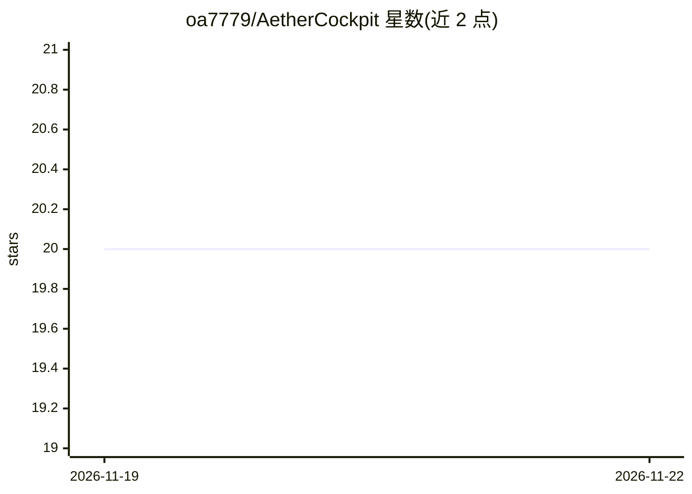

# oa7779/AetherCockpit

⭐ 20 · C# · MIT · 推送 2026-11-19 · [GitHub](https://github.com/oa7779/AetherCockpit) · 个人维护

**Windows 系统管理驾驶舱，集成硬件监控、诊断与本地 AI 助手**

面向 Windows 单机的统一管理面板，将任务管理器、设备管理器、事件查看器、服务、任务计划等分散工具的信息汇总到一个界面，覆盖 CPU/GPU/磁盘/传感器监控、SMART/NVMe 读取、事件/驱动/服务/自启动管理等，分析与变更分离，修改前需确认。内置本地 AI 助手：用 Phi 4 Mini 通过 Ollama 对系统数据做概括与解释，再用实际系统数据复核模型说法。提供 Setup、Portable 与可选多机 Server 包，当前为 Beta 55，构建未签名。

## 筛选速览

| 维度 | 判定 | 备注 |
|---|---|---|
| AI 角色 | `ai-enhanced` | 去掉 AI 部分产品仍成立 |
| 许可风险 | `permissive` | MIT |
| 部署形态 | `desktop` | 安装包/桌面程序 |
| 模型依赖 | local-ok | 支持本地模型 |
| 硬件要求 | — | 无带数字的原话,不猜 |
| 安装摩擦 | `low` | 无编译、无系统依赖或容器化 |
| 成熟度 | `idea` | |

## 能力要点

- 集中显示硬件传感器、进程、SMART/NVMe 与 Windows 诊断信息
- 本地 AI 助手用 Phi 4 Mini 概括数据，并用系统数据验证其说法
- 安装向导检查硬件与已有 Ollama 环境，使用独立的模型存储
- 可选 AETHER Server 用于多设备集中管理，单机无需服务器

## 适用场景

- 在一个界面里查看电脑温度、负载、磁盘健康与系统事件
- 不用切换多个 Windows 工具即可管理服务和驱动
- 让本地模型解释硬件状态并核对解释是否与实测一致
- 集中管理多台 Windows 设备的状态

## 场景标签

 · 领域:系统管理/桌面工具

## 证据(README 行号)

> L104: Analyse und Änderung bleiben getrennt. AETHER ändert Windows nicht ungefragt.
> L146: Windows und die Hardware liefern die eigentlichen Daten. Phi 4 Mini hilft
> L151: **AETHER misst. Das Modell hilft beim Einordnen.**

## 星数曲线

2026-11-19 20 → 2026-11-22 20（+0）

---
*卡片 v1 · prompt 1.4 · 生成 2026-11-19 · 置信度 high · 依据 README sha `3573dc15eee2` · [字段定义](../../DATASET.md)*
