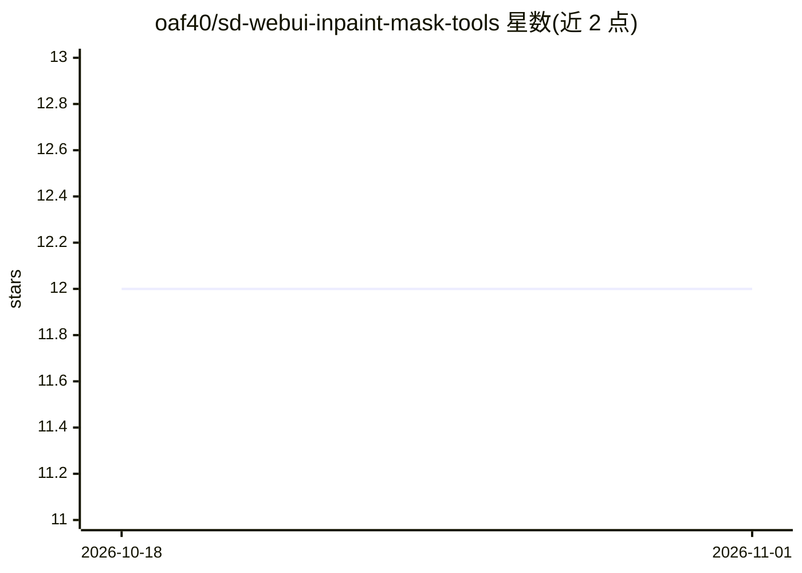

# oaf40/sd-webui-inpaint-mask-tools

⭐ 12 · Python · 推送 2026-06-26 · [GitHub](https://github.com/oaf40/sd-webui-inpaint-mask-tools) · 个人维护

**给 Stable Diffusion WebUI 用户的局部重绘（inpaint）蒙版尺寸自动调节扩展**

面向 A1111 Stable Diffusion WebUI 与 reForge 的扩展：在 Only masked 模式下按蒙版区域尺寸自动重算并应用宽高，对低于阈值的蒙版区域自动放大，提供 4 个蒙版尺寸快捷测量按钮、Whole picture 模式异常尺寸熔断，以及宽高自动取整到 32 倍数以防边缘瑕疵。功能通过 Quicksettings 集成，配置后即生效。已知限制：测量操作需将蒙版与图像从前端发送到后端，大图或远程 WebUI 实例会产生明显延迟（Gradio 限制）。

## 筛选速览

| 维度 | 判定 | 备注 |
|---|---|---|
| AI 角色 | `ai-ecosystem` | LLM/agent 周边工具 |
| 许可风险 | `none` | — |
| 部署形态 | `None` |  |
| 模型依赖 | — | README 未给出锁定关系 |
| 硬件要求 | — | 无带数字的原话,不猜 |
| 安装摩擦 | `low` | 无编译、无系统依赖或容器化 |
| 成熟度 | — | 结构信号不足 |

## 能力要点

- Only masked 模式下按蒙版尺寸自动重算宽高
- 蒙版区域分辨率低于阈值时自动放大（可设 1–1.5 MP 目标）
- 4 个蒙版尺寸快捷测量按钮（计入 Blur 与 Padding）
- 宽高自动取整到 32 倍数，避免边缘视觉瑕疵

## 适用场景

- 局部重绘时避免用默认 1024×1024 导致的有效分辨率损失
- 在低分辨率蒙版区域上提高重绘细节
- 提交生成任务前估算蒙版尺寸以防 GPU OOM

## 场景标签

`图像生成` · 领域:内容生成

## 证据(README 行号)

> L7: 1. Install the extension in WebUI (A1111, reForge)
> L24: ### Autoadjusting Width and Height in "Only masked" mode.

## 星数曲线

2026-10-18 12 → 2026-11-01 12（+0）

---
*卡片 v1 · prompt 1.4 · 生成 2026-11-01 · 置信度 high · 依据 README sha `c9da3df5569f` · [字段定义](../../DATASET.md)*
