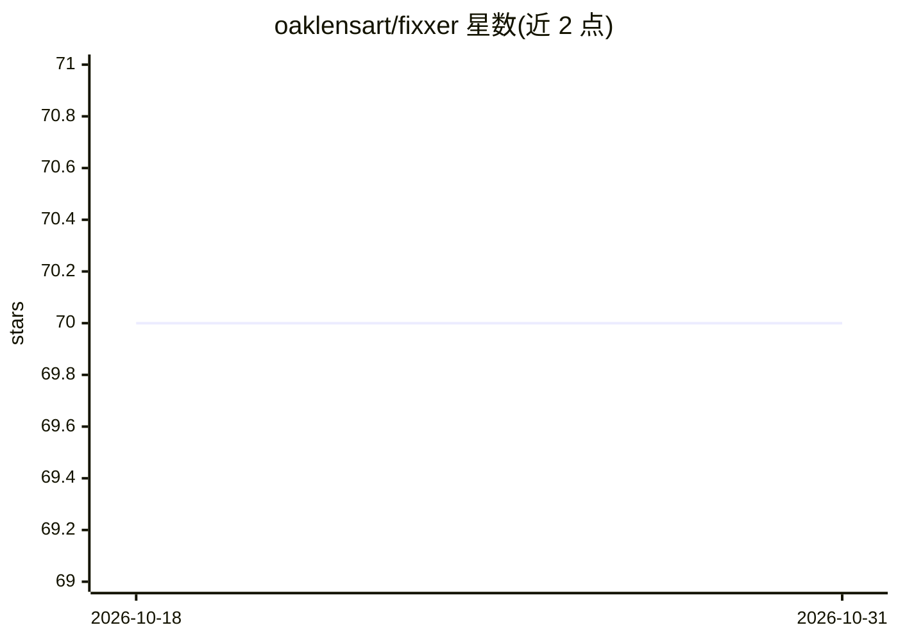

# oaklensart/fixxer

⭐ 70 · Python · 推送 2026-07-05 · [GitHub](https://github.com/oaklensart/fixxer) · [官网](https://www.oaklens.art/dev) · 个人维护

**摄影师后期工作流自动化工具：AI 命名、筛选与整理照片**

面向摄影师的照片后期处理流水线工具：以 CLIP 嵌入做连拍语义分组，BRISQUE 与直方图做锐度/曝光质量分析并自动分拣 Tier A/B/C，通过 Ollama（默认）或 OpenAI 兼容 API 的视觉模型生成描述性文件名与创作点评。文件操作全程 SHA256 校验并生成 JSON sidecar 审计记录，支持 120+ RAW 格式内存内处理。提供干跑预览、AI 结果缓存与全键盘操作；macOS 可经 Homebrew 安装，Linux/Windows 从源码安装。

## 筛选速览

| 维度 | 判定 | 备注 |
|---|---|---|
| AI 角色 | `ai-enhanced` | 去掉 AI 部分产品仍成立 |
| 许可风险 | `none` | — |
| 部署形态 | `None` |  |
| 模型依赖 | local-ok | 支持本地模型 |
| 硬件要求 | — | 无带数字的原话,不猜 |
| 安装摩擦 | `low` | 无编译、无系统依赖或容器化 |
| 成熟度 | — | 结构信号不足 |

## 能力要点

- Ollama 默认（零配置本地推理），兼容 llama.cpp/vLLM/LocalAI 等 OpenAI 兼容端点
- CLIP 语义连拍分组 + BRISQUE/直方图质量分析与 A/B/C 自动分拣
- SHA256 哈希校验的文件移动与 .fixxer.json 审计 sidecar
- 支持 120+ RAW 格式的内存内处理，含干跑预览与 AI 缓存

## 适用场景

- 拍摄后自动按语义分组成组、分拣并归档最佳照片
- 用本地视觉模型批量生成描述性文件名与关键词目录
- 在不动文件的前提下预览整个整理流程，确认后再执行

## 场景标签

`工作流自动化` `图像视频处理` · 领域:效率与自动化

## 证据(README 行号)

> L14: FIXXER is a professional photography workflow automation tool that combines **AI vision models**, **cryptographic i
> L27: - **Vision-based naming** using Ollama or OpenAI-compatible APIs (qwen2.5vl, llava, etc.)
> L58: - **macOS** (Homebrew installation) or **Python 3.10-3.12** for manual install

## 星数曲线

2026-10-18 70 → 2026-10-31 70（+0）

---
*卡片 v1 · prompt 1.4 · 生成 2026-10-24 · 置信度 high · 依据 README sha `436b56631c4d` · [字段定义](../../DATASET.md)*
