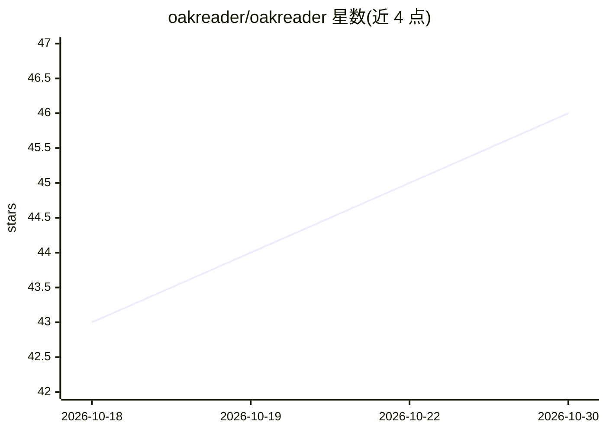

# oakreader/oakreader

⭐ 46 · Swift · MIT · 推送 2026-10-16 · [GitHub](https://github.com/oakreader/oakreader) · [官网](https://oakreader.com) · 个人维护 · 中文 README

**macOS 原生 AI 阅读器：PDF/网页阅读、问答与个人知识库**

面向专业阅读者的 macOS 原生应用：管理 PDF、论文、书籍与保存的网页，提供标注、笔记、翻译（含 OCR）、朗读与内置网页阅读。AI 部分支持跨库检索问答、文档旁对话与翻译，回答带可点击的页面引文。模型可在设置中连接云服务商或兼容 API 的本地服务器；随附的 oak CLI 允许外部 agent 搜索目录、读取文档与笔记。技术栈为 SwiftUI/PDFKit/SQLite 后端，需 macOS 15.4+。

## 筛选速览

| 维度 | 判定 | 备注 |
|---|---|---|
| AI 角色 | `ai-native` | 本体是模型或模型工具 |
| 许可风险 | `permissive` | MIT |
| 部署形态 | `library` | 以包/库形式分发 |
| 模型依赖 | — | README 未给出锁定关系 |
| 硬件要求 | — | 无带数字的原话,不猜 |
| 安装摩擦 | `low` | 无编译、无系统依赖或容器化 |
| 成熟度 | — | 结构信号不足 |

## 能力要点

- 跨库/集合的检索问答，回答附页面级引用回链
- 标注、笔记（导出 Markdown）与参考信息管理
- 翻译面板支持选段与 OCR 截取区域
- oak CLI 供外部 agent 访问同一文档库

## 适用场景

- 在阅读论文和书籍时向 AI 提问并核对原文出处
- 把 PDF、网页、笔记集中到一个个人知识库
- 阅读外文资料时对照翻译并做笔记

## 场景标签

`知识库管理` `文档问答` `OCR` · 领域:知识与检索

## 证据(README 行号)

> L3: **A native macOS reader and AI knowledge base, shared by you and your agent.**
> L32:  Research across your sources

## 星数曲线

2026-10-18 43 → 2026-10-30 46（+3）

---
*卡片 v1 · prompt 1.4 · 生成 2026-10-25 · 置信度 mid · 依据 README sha `4a3c71aa4cb8` · [字段定义](../../DATASET.md)*
