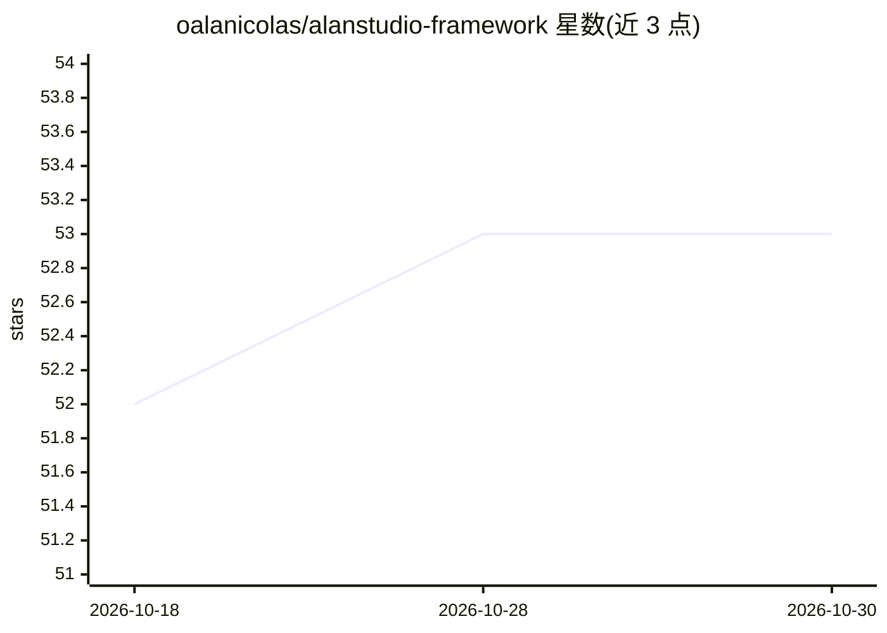

# oalanicolas/alanstudio-framework

⭐ 53 · Python · MIT · 推送 2026-10-19 · [GitHub](https://github.com/oalanicolas/alanstudio-framework) · [官网](https://games.alanicolas.com/framework) · 个人维护

**供 AI agent 创建与迭代游戏的轻量 harness（非引擎）**

Python 编写的游戏开发 harness：提供 doctor/discover/start/guide/play/next 等 CLI 工具，供 agent 与创作者围绕既有引擎和资产进行游戏切片的创建、审查、推进与观察记录。它读取项目磁盘状态（九个最小领域的候选、音频角色、feel 常量、playtest 发现等）生成信号与下一步命令，但不执行游戏、不排名、不发布。明确声明不是引擎。macOS/Linux、Python 3.10+、仅标准库，测试涉及 package.json 时另需 Node/npm。

## 筛选速览

| 维度 | 判定 | 备注 |
|---|---|---|
| AI 角色 | `ai-ecosystem` | LLM/agent 周边工具 |
| 许可风险 | `permissive` | MIT |
| 部署形态 | `library` | 以包/库形式分发 |
| 模型依赖 | — | README 未给出锁定关系 |
| 硬件要求 | — | 无带数字的原话,不猜 |
| 安装摩擦 | `medium` | 含编译或系统依赖之一 |
| 成熟度 | — | 结构信号不足 |

## 能力要点

- discover 扫描游戏目录并输出九个领域的完成/草稿状态与缺口信号
- start/guide/play 生成可执行的下一步命令与 JSON 回执（不代执行）
- 多 workspace 共享单一 framework 实现（framework/core 链接机制）
- 仅 Python 标准库，无依赖安装；配套 game-dev skill 供对话式使用

## 适用场景

- 让 AI agent 按对话请求创建或改进一个游戏切片
- 审查游戏实验室里多个项目的状态与缺口
- 为游戏开发流程提供可验证的步骤与观察记录

## 场景标签

`Agent 框架` · 领域:Agent 开发

## 证据(README 行号)

> L3: Harness thin para criar, evoluir e produzir games com IA. Compartilha conceitos,
> L23: Com a skill `game-dev` disponível, descreva o que quer criar ou melhorar:
> L34: Os comandos abaixo são ferramentas do agente e também podem ser usados diretamente.

## 星数曲线

2026-10-18 52 → 2026-10-30 53（+1）

---
*卡片 v1 · prompt 1.4 · 生成 2026-10-24 · 置信度 mid · 依据 README sha `89e13e8a2d62` · [字段定义](../../DATASET.md)*
