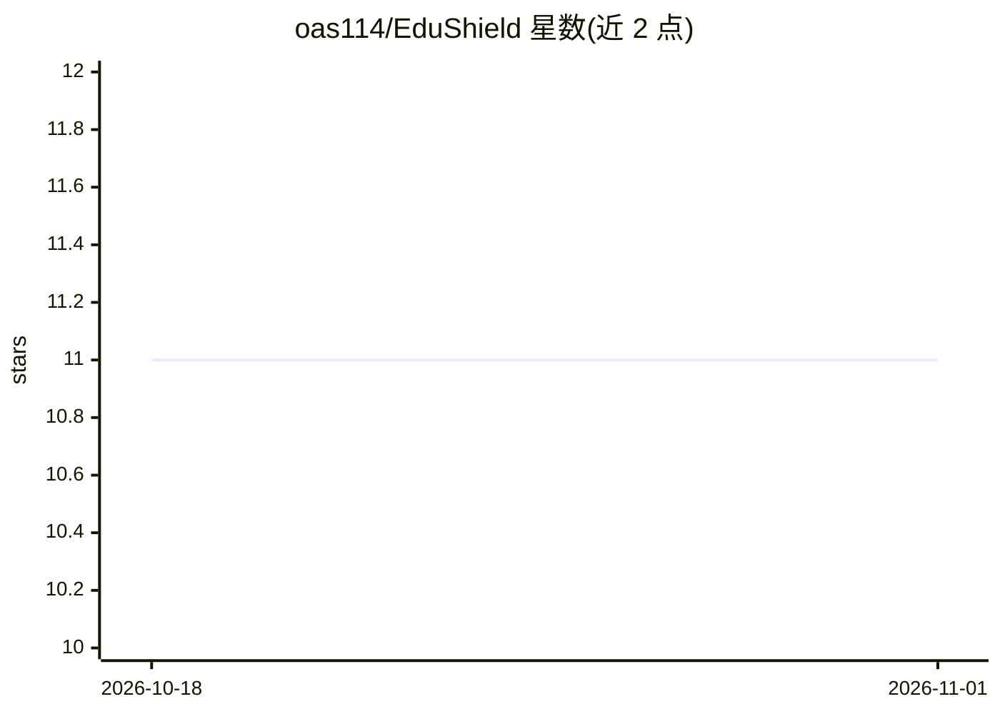

# oas114/EduShield

⭐ 11 · HTML · MIT · 推送 2026-08-31 · [GitHub](https://github.com/oas114/EduShield) · [官网](https://oasgrow.com/EduShield/) · 个人维护 · 中文 README

**台灣教育場域專用的純前端個資去識別化與還原工具**

單一靜態 HTML 檔案構成的零信任去識別化工具：使用者將含個資的文件貼入後，以內建正則規則（20+ 種台灣格式個資類型）將敏感資訊替換為代碼，送外部 AI 處理後再透過三重容錯比對演算法還原；全程在瀏覽器記憶體執行，無後端、不寫碟。可選整合地端 Ollama（建議 qwen2.5:3b）做語意實體擷取與風險評估，另設 36 個硬阻斷關鍵詞的鎖定機制。README 聲明不構成法規遵循保證。

## 筛选速览

| 维度 | 判定 | 备注 |
|---|---|---|
| AI 角色 | `ai-enhanced` | 去掉 AI 部分产品仍成立 |
| 许可风险 | `permissive` | MIT |
| 部署形态 | `None` |  |
| 模型依赖 | local-ok | 支持本地模型 |
| 硬件要求 | — | 无带数字的原话,不猜 |
| 安装摩擦 | `low` | 无编译、无系统依赖或容器化 |
| 成熟度 | — | 结构信号不足 |

## 能力要点

- 單一 HTML 檔案、無後端無資料庫，全部運算在本機瀏覽器記憶體
- 內建 20+ 種台灣個資格式的正則遮蔽規則與 sessionVault 代碼還原機制
- 可選地端 Ollama 語意掃描（實體擷取＋風險評估）
- 36 個硬阻斷關鍵詞觸發紅色警示並鎖定複製按鈕

## 适用场景

- 把學生評語、輔導紀錄送 AI 潤飾前先遮蔽個資
- 在公務機或封閉內網環境離線處理含個資文件
- 遮蔽後送 AI 處理再一鍵還原原始內容

## 场景标签

 · 领域:教育/資料隱私

## 证据(README 行号)

> L28: EduShield 是**單一靜態 HTML 檔案**。沒有後端、沒有資料庫、沒有 API 伺服器。所有運算——正則比對、代碼替換、還原、與 AI 互動——都在您**本機瀏覽器的記憶體**中執行。
> L47: **第一層 — 靜態正則快速比對**

## 星数曲线

2026-10-18 11 → 2026-11-01 11（+0）

---
*卡片 v1 · prompt 1.4 · 生成 2026-11-01 · 置信度 high · 依据 README sha `abdb36a05e30` · [字段定义](../../DATASET.md)*
