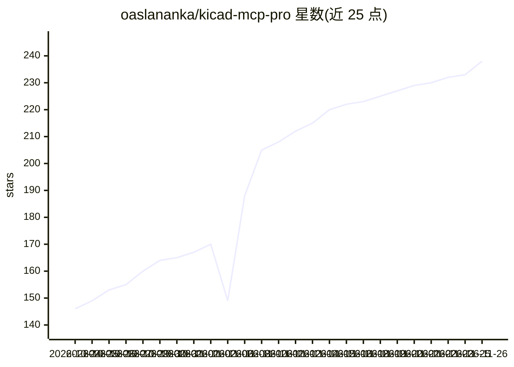

# oaslananka/kicad-mcp-pro

⭐ 238 · Python · AGPL-3.0 · 推送 2026-11-25 · [GitHub](https://github.com/oaslananka/kicad-mcp-pro) · [官网](https://oaslananka.github.io/kicad-mcp-pro/) · 个人维护

**MCP 服务器：让 AI agent 驱动 KiCad 原理图/PCB 审查与制造流程**

面向 KiCad EDA 工作流的 Model Context Protocol 服务器，暴露工具、资源与提示，覆盖原理图、PCB、ERC/DRC 校验、DFM 检查、BOM 分析与制造导出。启动时默认只加载 25 个只读审查工具的 bounded 配置，写操作走 build/release 配置并由人工门控。ERC/DRC 与导出调用 KiCad 自身引擎；信号完整性等为一级闭式估算（约 5–10% 精度）。提供 uv/npx 安装、本地 HTTP 端点与浏览器 dashboard，Cloud 远程为可选项。

## 筛选速览

| 维度 | 判定 | 备注 |
|---|---|---|
| AI 角色 | `ai-ecosystem` | LLM/agent 周边工具 |
| 许可风险 | `viral` | AGPL-3.0 |
| 部署形态 | `library` | 以包/库形式分发 |
| 模型依赖 | — | README 未给出锁定关系 |
| 硬件要求 | — | 无带数字的原话,不猜 |
| 安装摩擦 | `low` | 无编译、无系统依赖或容器化 |
| 成熟度 | — | 结构信号不足 |

## 能力要点

- 默认 bounded 配置仅加载 25 个只读工具，支持 build/release/expert 分级配置
- ERC/DRC 与导出管线驱动 KiCad 自身引擎
- stdio 与 Streamable HTTP 双传输，支持协议版本协商
- 内置 capability parity 工具，报告对 KiCad 可编程面的覆盖率（当前 76.6%）

## 适用场景

- 让 Claude 等 MCP 客户端对 KiCad 工程做 ERC/DRC 与 DFM 首轮审查
- 受控编辑 PCB 并经人工审批走制造发布流程
- 分析 BOM 并使用 JLCPCB 目录进行元器件选型查询
- 导出 Gerber 等制造文件前做自动化检查

## 场景标签

 · 领域:EDA/电子设计自动化

## 证据(README 行号)

> L34: KiCad MCP Pro is a Model Context Protocol server for KiCad EDA workflows. It exposes tools, resources, and prompts 
> L36: The server now starts with the bounded `default` profile: 25 read-only review tools instead of the complete expert 

## 星数曲线

2026-10-24 146 → 2026-11-26 238（+92）

---
*卡片 v1 · prompt 1.4 · 生成 2026-11-25 · 置信度 high · 依据 README sha `46665c403700` · [字段定义](../../DATASET.md)*
