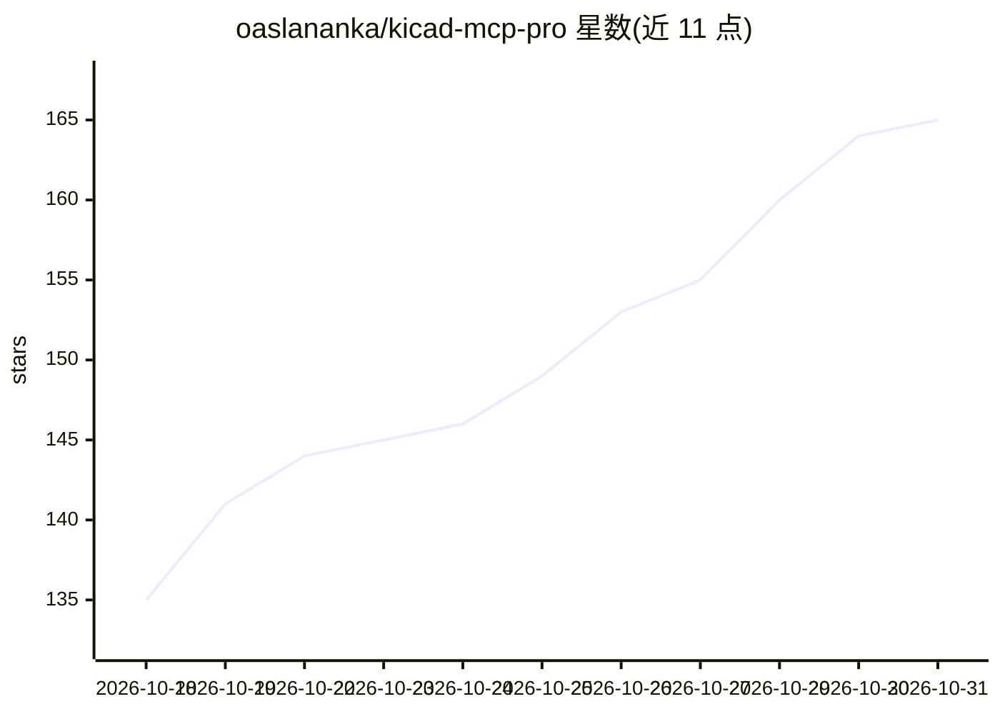

# oaslananka/kicad-mcp-pro

⭐ 165 · Python · MIT · 推送 2026-10-30 · [GitHub](https://github.com/oaslananka/kicad-mcp-pro) · [官网](https://oaslananka.github.io/kicad-mcp-pro/) · 个人维护

**连接 AI agent 与 KiCad 电路设计的 MCP 服务器**

面向 KiCad EDA 工作流的 Model Context Protocol 服务器，向 MCP 客户端暴露原理图、PCB、ERC/DRC 校验、DFM 检查、BOM 与制造导出等工具、资源与提示词。默认以 24 个只读工具的 default profile 启动，另有 build/release/expert 等分级披露模式，其中 release 为人工把关的制造交付流程。信号完整性等工具为一阶闭式估算（约 5-10% 精度），生成输出需人工审核。支持 stdio 与 Streamable HTTP 传输，提供 PyPI/npm 包、Tauri 桌面安装包与网页仪表盘，并附带 Claude/Codex/VS Code 等 agent 配置示例与 KiCad 技能文件。

## 筛选速览

| 维度 | 判定 | 备注 |
|---|---|---|
| AI 角色 | `ai-ecosystem` | LLM/agent 周边工具 |
| 许可风险 | `permissive` | MIT |
| 部署形态 | `desktop` | 安装包/桌面程序 |
| 模型依赖 | locked-api |  |
| 硬件要求 | — | 无带数字的原话,不猜 |
| 安装摩擦 | `low` | 无编译、无系统依赖或容器化 |
| 成熟度 | — | 结构信号不足 |

## 能力要点

- 分级披露 profile：default 24 个只读工具，build/release 提供受控编辑与人工把关交付
- ERC/DRC 与导出管线驱动 KiCad 自身引擎，能力覆盖度报告当前为 76.6%
- 支持 stdio 与 Streamable HTTP 传输，提供 PyPI 包、npm wrapper 与 Tauri 桌面安装包
- 附带 KiCad 设计评审/PCB/DRC/制造导出等技能文件与多 agent 运行时配置示例

## 适用场景

- 在 Claude Code、Copilot 等 MCP 客户端中驱动 KiCad 原理图与 PCB 操作
- 通过 AI agent 执行 ERC/DRC 校验、DFM 检查与 Gerber 制造导出
- 为 PCB 设计流程提供 BOM 分析与元器件选型查询
- 以人工把关的 release 流程准备制造交付包

## 场景标签

 · 领域:EDA/硬件设计工具

## 证据(README 行号)

> L32: KiCad MCP Pro is a Model Context Protocol server for KiCad EDA workflows. It exposes tools, resources, and prompts 
> L130: KiCad MCP Pro supports `stdio` and Streamable HTTP. Streamable HTTP is served at

## 星数曲线

2026-10-18 135 → 2026-10-31 165（+30）

---
*卡片 v1 · prompt 1.4 · 生成 2026-10-22 · 置信度 high · 依据 README sha `6cd880e9b9cb` · [字段定义](../../DATASET.md)*
