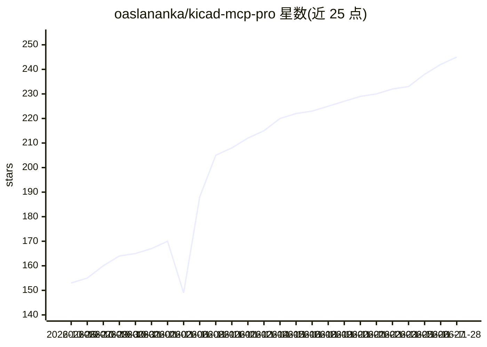

# oaslananka/kicad-mcp-pro

⭐ 245 · Python · AGPL-3.0 · 推送 2026-11-27 · [GitHub](https://github.com/oaslananka/kicad-mcp-pro) · [官网](https://oaslananka.github.io/kicad-mcp-pro/) · 个人维护

**把 KiCad 原理图/PCB 工作流接入 AI agent 的 MCP 服务器**

面向 KiCad EDA 的 Model Context Protocol 服务器，向 MCP 客户端暴露原理图、PCB、ERC/DRC 校验、DFM 检查、BOM 分析与制造导出（含 Gerber）等工具、资源与提示。默认以 25 个只读审阅工具的 bounded profile 启动，提供 build（受控写）、release（人工门禁交接）等扩展 profile；ERC/DRC 与导出调用 KiCad 自身引擎，信号完整性等工具为一阶估算（约 5-10% 精度）。支持 stdio 与 Streamable HTTP 传输、浏览器 dashboard、CLI 配置/体检命令，遥测默认关闭；AGPL-3.0 许可。

## 筛选速览

| 维度 | 判定 | 备注 |
|---|---|---|
| AI 角色 | `ai-ecosystem` | LLM/agent 周边工具 |
| 许可风险 | `viral` | AGPL-3.0 |
| 部署形态 | `library` | 以包/库形式分发 |
| 模型依赖 | — | README 未给出锁定关系 |
| 硬件要求 | — | 无带数字的原话,不猜 |
| 安装摩擦 | `low` | 无编译、无系统依赖或容器化 |
| 成熟度 | — | 结构信号不足 |

## 能力要点

- 通过 MCP 向任意 AI agent 暴露 KiCad 原理图/PCB/DRC/DFM/制造导出工具
- 默认只读审阅 profile，受控编辑与人工门禁的发布工作流
- 支持 stdio 与 Streamable HTTP 传输及浏览器 dashboard
- 内置能力对等矩阵，报告可驱动的 KiCad 编程面比例（76.6%）

## 适用场景

- 让 Claude Code 等 MCP 客户端读取并审阅 KiCad 项目
- 对 PCB 设计做 ERC/DRC/DFM 第一轮检查
- 导出 Gerber 并做 BOM 与制造准备
- 以只读模式安全接入 AI 工具进行设计评审

## 场景标签

 · 领域:EDA/硬件开发工具

## 证据(README 行号)

> L34: KiCad MCP Pro is a Model Context Protocol server for KiCad EDA workflows. It exposes tools, resources, and prompts 
> L36: The server now starts with the bounded `default` profile: 25 read-only review tools instead of the complete expert 
> L3:  Drive KiCad schematic, PCB, DRC/ERC, DFM, and manufacturing review from any MCP-capable AI agent.

## 星数曲线

2026-10-26 153 → 2026-11-28 245（+92）

---
*卡片 v1 · prompt 1.4 · 生成 2026-11-28 · 置信度 high · 依据 README sha `9aa969645566` · [字段定义](../../DATASET.md)*
