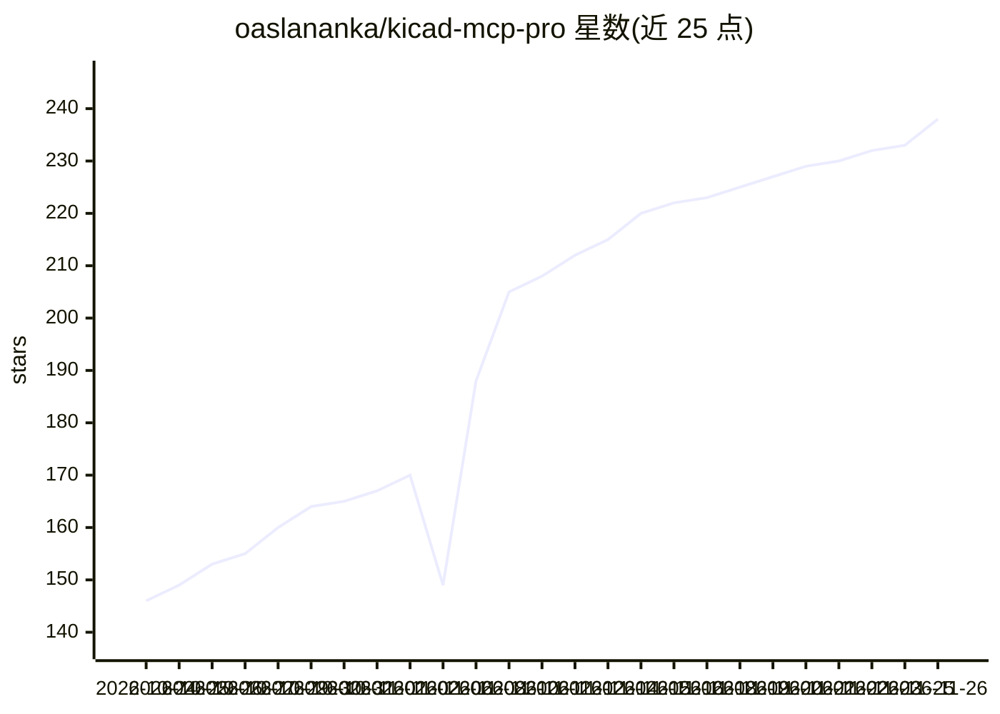

# oaslananka/kicad-mcp-pro

⭐ 238 · Python · AGPL-3.0 · 推送 2026-11-25 · [GitHub](https://github.com/oaslananka/kicad-mcp-pro) · [官网](https://oaslananka.github.io/kicad-mcp-pro/) · 个人维护

**把 AI agent 接入 KiCad 原理图/PCB 流程的 MCP server**

面向 KiCad EDA 工作流的 Model Context Protocol 服务器：暴露工具、资源与提示，覆盖原理图、PCB、ERC/DRC 验证、DFM 检查、BOM 分析与制造导出，编辑受控并由人工把关发布流程。默认以 25 个只读评审工具的 bounded profile 启动，可切换 build/release/expert 等写入或制造模式；支持 stdio 与 Streamable HTTP 传输、本地浏览器仪表盘，以及可选的 Cloud 远程（需设备配对与所有者授权）。ERC/DRC 与导出实际调用 KiCad 自身引擎；信号完整性等工具为闭式一阶估算（约 5–10% 精度），非场求解器替代。通过 uvx/uv tool 与 npm 包装器分发。

## 筛选速览

| 维度 | 判定 | 备注 |
|---|---|---|
| AI 角色 | `ai-enhanced` | 去掉 AI 部分产品仍成立 |
| 许可风险 | `viral` | AGPL-3.0 |
| 部署形态 | `library` | 以包/库形式分发 |
| 模型依赖 | — | README 未给出锁定关系 |
| 硬件要求 | — | 无带数字的原话,不猜 |
| 安装摩擦 | `low` | 无编译、无系统依赖或容器化 |
| 成熟度 | — | 结构信号不足 |

## 能力要点

- 默认 25 个只读评审工具，写入与发布模式分级授权
- 支持 stdio 与 Streamable HTTP 两种传输及浏览器仪表盘
- ERC/DRC 与导出管线调用 KiCad 自身引擎
- 内置 kicad_capability_parity() 报告覆盖 KiCad 可编程表面的比例

## 适用场景

- 让 MCP 客户端驱动 KiCad 的 ERC/DRC 与 DFM 评审
- 生成制造准备所需的 BOM 分析与导出产物
- 以只读 profile 安全地审查电路设计

## 场景标签

 · 领域:EDA 工具链/AI agent 接入

## 证据(README 行号)

> L34: KiCad MCP Pro is a Model Context Protocol server for KiCad EDA workflows. It exposes tools, resources, and prompts 
> L36: The server now starts with the bounded `default` profile: 25 read-only review tools instead of the complete expert 

## 星数曲线

2026-10-24 146 → 2026-11-26 238（+92）

---
*卡片 v1 · prompt 1.4 · 生成 2026-11-26 · 置信度 high · 依据 README sha `88cfbf8bd97c` · [字段定义](../../DATASET.md)*
