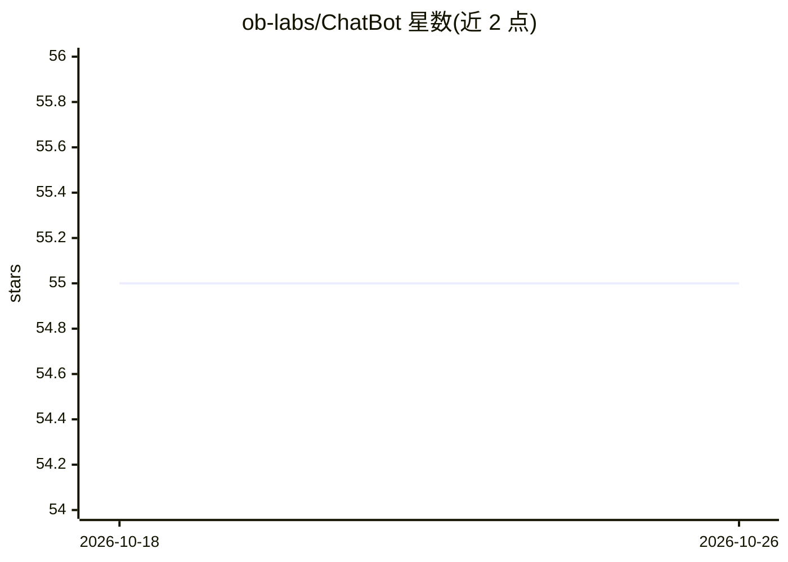

# ob-labs/ChatBot

⭐ 55 · Python · MIT · 推送 2026-04-26 · [GitHub](https://github.com/ob-labs/ChatBot) · [官网](https://en.oceanbase.com) · 组织维护 · 中文 README

**基于 OceanBase 向量检索的 RAG 文档问答 Chatbot 教学项目**

OceanBase AI Workshop 的配套工程：将 OceanBase 开源文档转为向量与结构化数据存入 OceanBase 4.3.5，用户提问经通义千问 embedding 向量化后在数据库中做向量检索，再结合检索内容调用通义千问大模型生成流式回答。组件含 embedding 服务、OceanBase 存储、多个 LLM agent 与 Streamlit 聊天界面。需注册阿里云百炼获取 API Key，数据库可用 OB Cloud 免费实例或 Docker 部署，通过 make 命令安装依赖与启动。

## 筛选速览

| 维度 | 判定 | 备注 |
|---|---|---|
| AI 角色 | `ai-native` | 本体是模型或模型工具 |
| 许可风险 | `permissive` | MIT |
| 部署形态 | `library` | 以包/库形式分发 |
| 模型依赖 | — | README 未给出锁定关系 |
| 硬件要求 | — | 无带数字的原话,不猜 |
| 安装摩擦 | `low` | 无编译、无系统依赖或容器化 |
| 成熟度 | — | 结构信号不足 |

## 能力要点

- 文档向量化后存入 OceanBase 并用 HNSW 索引做向量检索
- 调用通义千问 embedding 与 LLM 生成流式回答，默认 qwen-turbo-2024-11-01
- 支持加载压缩包、多个 markdown 文件与 GitHub 地址作为数据源
- 提供 Streamlit Web 聊天界面，LLM 模型可经环境变量或界面切换

## 适用场景

- 对 OceanBase 文档搭建领域问答系统
- 学习 RAG 的向量检索与生成流程
- 体验 OceanBase 的向量存储与 HNSW 索引能力

## 场景标签

`文档问答` `RAG` `教程课程` · 领域:知识与检索

## 证据(README 行号)

> L7: In this workshop, we will build a RAG chatbot that answers questions related to OceanBase documentation. It uses ope
> L26: 5. The chatbot sends the user's question and retrieved documents to the large language model and requests it to gen

## 星数曲线

2026-10-18 55 → 2026-10-26 55（+0）

---
*卡片 v1 · prompt 1.4 · 生成 2026-10-24 · 置信度 mid · 依据 README sha `e8ff413058e8` · [字段定义](../../DATASET.md)*
