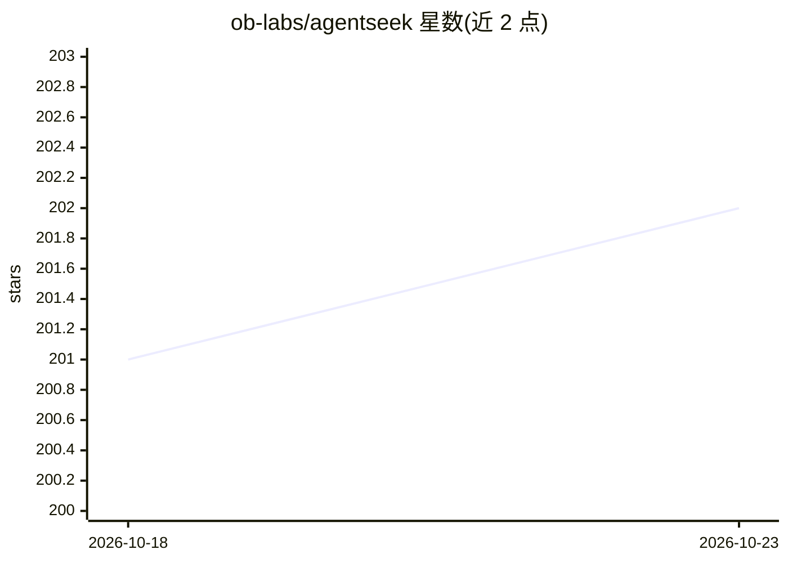

# ob-labs/agentseek

⭐ 202 · Python · Apache-2.0 · 推送 2026-10-08 · [GitHub](https://github.com/ob-labs/agentseek) · [官网](https://ob-labs.github.io/agentseek/) · 组织维护 · 中文 README

**本地 AI Agent 应用开发生命周期工具包：模板生成、运行与观测**

OceanBase OSS 团队开发的模板优先 CLI 工具包，围绕可编辑的本地 agent 应用提供完整生命周期：create 从锁定版本的模板目录（agentseek-ai/agentseek-templates）渲染可编辑项目，info 展示拓扑与入口，doctor 做就绪检查与健康监测，dev 启动本地开发栈。生成的项目归属用户，自选运行时与集成（模型、工具、MCP 服务）。随附 deepagents/research 模板（LangGraph 后端 + React 前端），支持 JSON 契约输出与可选 LangSmith 追踪。Python 包经 PyPI 发布，Apache-2.0 许可。

## 筛选速览

| 维度 | 判定 | 备注 |
|---|---|---|
| AI 角色 | `ai-ecosystem` | LLM/agent 周边工具 |
| 许可风险 | `permissive` | Apache-2.0 |
| 部署形态 | `library` | 以包/库形式分发 |
| 模型依赖 | — | README 未给出锁定关系 |
| 硬件要求 | — | 无带数字的原话,不猜 |
| 安装摩擦 | `medium` | 含编译或系统依赖之一 |
| 成熟度 | — | 结构信号不足 |

## 能力要点

- 从锁定 commit 的不可变模板目录渲染可编辑项目
- create/info/task/doctor/dev 覆盖发现到迭代的生命周期命令
- 版本化 JSON 契约供桌面客户端与机器消费，不暴露环境变量
- 可选 LangSmith 追踪观察单次 agent 运行内部行为

## 适用场景

- 从模板快速创建可编辑的本地 DeepAgents 研究应用
- 统一管理本地 agent 项目的就绪检查与运行栈启停
- 通过 JSON 输出把项目状态接入桌面客户端或脚本

## 场景标签

`Agent 框架` `LLM 可观测性` · 领域:Agent 开发

## 证据(README 行号)

> L28: AgentSeek is a template-first toolkit for local agent application development.
> L59: AgentSeek supplies the stable lifecycle surface around a generated project; it
> L65: The CLI connects people, coding agents, and desktop clients to a locked,

## 星数曲线

2026-10-18 201 → 2026-10-23 202（+1）

---
*卡片 v1 · prompt 1.4 · 生成 2026-10-22 · 置信度 high · 依据 README sha `3b074451133d` · [字段定义](../../DATASET.md)*
