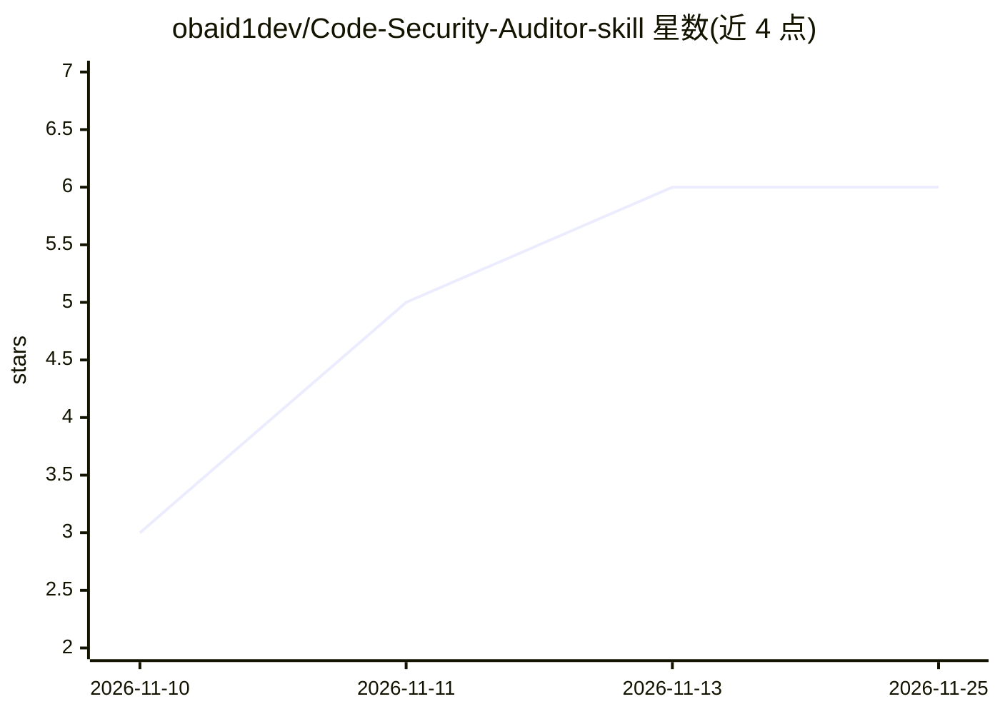

# obaid1dev/Code-Security-Auditor-skill

⭐ 6 · Python · MIT · 推送 2026-11-08 · [GitHub](https://github.com/obaid1dev/Code-Security-Auditor-skill) · 个人维护

**面向开发者的 AI 代码安全审计技能：定位漏洞并应用最小修复补丁**

以 Claude skill 形式运行的代码安全审计工具：扫描源码、配置、.env、Docker 与 CI 文件，按 OWASP Top 10 类风险检测注入、密钥泄漏、访问控制、加密弱点等问题，为每个发现给出 file:line、CWE 与严重级；随后应用行为保持的最小补丁并复扫验证，生成 SECURITY_AUDIT.md 前后对比报告，可选 SARIF 输出。附带约 70 条规则的独立 Python 预扫描器（Python 3.9+，无依赖），可脱离 Claude 从终端运行。

## 筛选速览

| 维度 | 判定 | 备注 |
|---|---|---|
| AI 角色 | `ai-native` | 本体是模型或模型工具 |
| 许可风险 | `permissive` | MIT |
| 部署形态 | `None` |  |
| 模型依赖 | locked-api |  |
| 硬件要求 | — | 无带数字的原话,不猜 |
| 安装摩擦 | `low` | 无编译、无系统依赖或容器化 |
| 成熟度 | — | 结构信号不足 |

## 能力要点

- 六阶段流程：映射入口→检测→定位评分→打补丁→验证→报告
- 发现附带 file:line、CWE、严重级与置信度，支持 SARIF 供 GitHub code scanning 使用
- 独立扫描器无第三方依赖（Python 3.9+），密钥值始终脱敏
- 支持完整审计+修复、仅报告、PR/diff 审查、快速分诊等模式

## 适用场景

- 提交或上线前对整个仓库做一次安全审计并自动修复
- 在发布移动应用前扫描泄漏的 API 密钥
- 审查 PR diff 中引入的漏洞
- 检查 Supabase 等后端配置是否缺少 RLS

## 场景标签

`代码审查` · 领域:编码与开发

## 证据(README 行号)

> L6: An AI skill that works like a security engineer inside your workflow. It walks your whole codebase, finds vulnerabil
> L8: Works with **Claude** (Claude.ai, Claude Code, Cowork) as a `.skill`, and the bundled scanner also runs standalone f

## 星数曲线

2026-11-10 3 → 2026-11-25 6（+3）

---
*卡片 v1 · prompt 1.4 · 生成 2026-11-20 · 置信度 high · 依据 README sha `021360c54f1f` · [字段定义](../../DATASET.md)*
