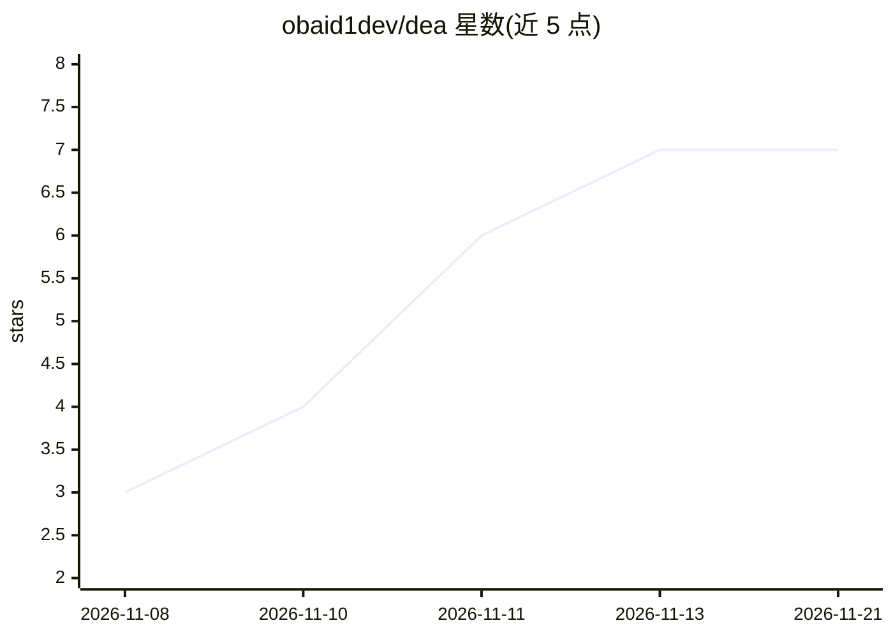

# obaid1dev/dea

⭐ 7 · Python · MIT · 推送 2026-11-08 · [GitHub](https://github.com/obaid1dev/dea) · 个人维护

**给 agent 用的网站设计系统提取技能：产出 tokens 与设计文档**

以 SKILL.md 文件夹形式分发的 agent 技能：指定任一网站后，用 Playwright 或 agent 浏览器工具在真实浏览器中测量计算样式，截取桌面/平板/移动三视口与深色模式截图，捕获 hover/focus 状态，生成含颜色角色、字阶、间距、动效、组件与页面结构的 DESIGN.md、tokens.json、tokens.css、Tailwind 配置等产物。按 Playwright/浏览器工具/静态 CSS/仅截图四级降级运行；脚本也可脱离 agent 独立执行。要求 Node 18+ 与 Python 3.9+，MIT 许可。

## 筛选速览

| 维度 | 判定 | 备注 |
|---|---|---|
| AI 角色 | `ai-ecosystem` | LLM/agent 周边工具 |
| 许可风险 | `permissive` | MIT |
| 部署形态 | `library` | 以包/库形式分发 |
| 模型依赖 | — | README 未给出锁定关系 |
| 硬件要求 | — | 无带数字的原话,不猜 |
| 安装摩擦 | `low` | 无编译、无系统依赖或容器化 |
| 成熟度 | — | 结构信号不足 |

## 能力要点

- 真实浏览器捕获计算样式、三视口截图与 hover/focus 状态
- 四级捕获降级：Playwright、浏览器工具、静态 CSS、仅截图
- 输出 DESIGN.md、tokens.json、tokens.css（shadcn 兼容命名）与 Tailwind v3/v4 配置
- 脚本可独立运行，无需 agent

## 适用场景

- 从参考网站提取设计系统并按其风格重构自己的应用
- 在不复制品牌资产的前提下将现有项目改为参考站点的视觉风格
- 文档化已有站点的设计系统与设计 token

## 场景标签

`浏览器自动化` · 领域:效率与自动化

## 证据(README 行号)

> L11: Agent skill
> L19: Tell your agent which site's design you want. DEA opens it in a real browser, measures every computed style, screen
> L129:   SKILL.md                      workflow, modes, rules

## 星数曲线

2026-11-08 3 → 2026-11-21 7（+4）

---
*卡片 v1 · prompt 1.4 · 生成 2026-11-20 · 置信度 high · 依据 README sha `1180645e1da9` · [字段定义](../../DATASET.md)*
