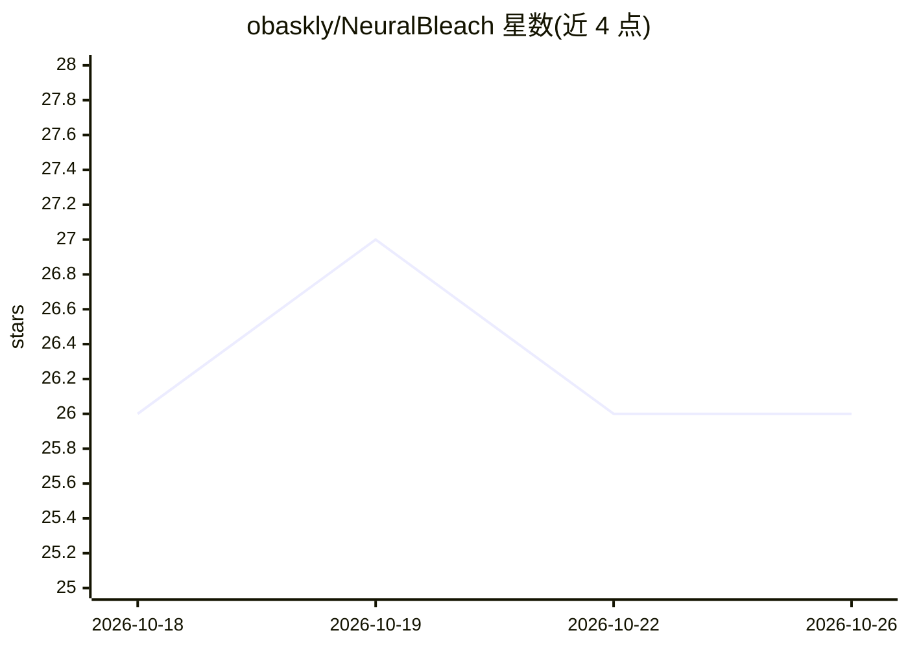

# obaskly/NeuralBleach

⭐ 26 · Python · 推送 2026-02-04 · [GitHub](https://github.com/obaskly/NeuralBleach) · 个人维护

**概念验证工具：用扩散重建移除图像中的隐形 AI 水印**

面向网络安全研究与 CTF 竞赛的概念验证（POC）脚本：通过 Stable Diffusion（Realistic Vision V5.1）以 0.20–0.25 强度重绘图像覆盖频域水印，配合 ControlNet Canny 边缘检测锁定文字与结构，再注入色差和胶片颗粒模拟相机瑕疵，最后剥离 EXIF/XMP/C2PA 元数据。提供 Google Colab 免 GPU 运行路径与本地脚本两种方式，本地需 NVIDIA GPU（RTX 3060 以上为建议配置）。声明仅限教育用途。

## 筛选速览

| 维度 | 判定 | 备注 |
|---|---|---|
| AI 角色 | `ai-native` | 本体是模型或模型工具 |
| 许可风险 | `none` | — |
| 部署形态 | `library` | 以包/库形式分发 |
| 模型依赖 | — | README 未给出锁定关系 |
| 硬件要求 | — | 无带数字的原话,不猜 |
| 安装摩擦 | `low` | 无编译、无系统依赖或容器化 |
| 成熟度 | `idea` | |

## 能力要点

- 扩散重绘（strength 0.20–0.25）覆盖频域隐藏水印信号
- ControlNet Canny 边缘锁定保持文字、Logo 与人脸结构
- 注入色差与 ISO-400 胶片颗粒的视觉仿真模块
- 自动剥离 EXIF/XMP/C2PA 元数据

## 适用场景

- 研究数字水印技术的鲁棒性
- CTF 竞赛中处理带水印图像挑战
- 在没有 GPU 的环境下通过 Colab 运行实验

## 场景标签

`网络安全` `图像视频处理` · 领域:学习与行业

## 证据(README 行号)

> L5: **NeuralBleach** is a proof-of-concept utility for bypassing frequency-domain watermarking. NeuralBleach leverages a
> L10: Uses **Realistic Vision V5.1** (a photorealistic finetune of Stable Diffusion) to "re-dream" the image pixels.

## 星数曲线

2026-10-18 26 → 2026-10-26 26（+0）

---
*卡片 v1 · prompt 1.4 · 生成 2026-10-26 · 置信度 high · 依据 README sha `d2059156a357` · [字段定义](../../DATASET.md)*
