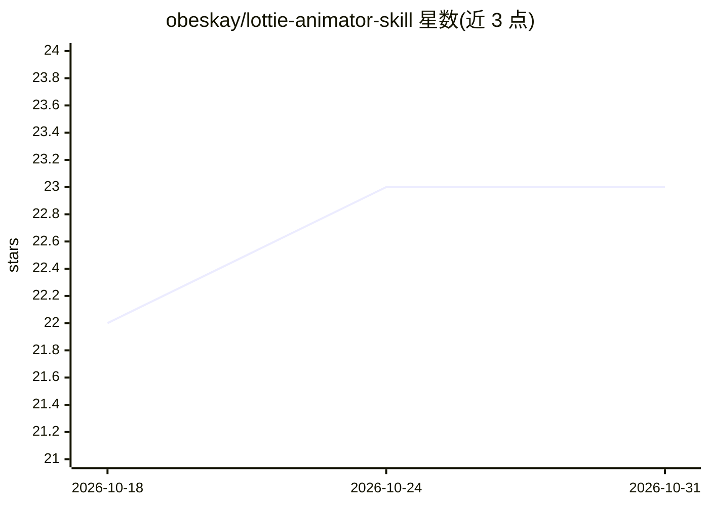

# obeskay/lottie-animator-skill

⭐ 23 · Python · MIT · 推送 2026-10-01 · [GitHub](https://github.com/obeskay/lottie-animator-skill) · [官网](https://obeskay.com) · 个人维护

**Claude Code 技能：从配方或 SVG 生成 Lottie 动画并自检渲染**

面向 Claude Code 的 Lottie 动画技能：提供 22 个动画配方（可在 9 个调色板中换肤）、SVG→Lottie 转换器、检测导致空白渲染缺陷的 linter，以及用真实 lottie-web 渲染逐帧PNG与洋葱皮以供 agent 检查的渲染器；工作流为 build→lint→render→LOOK→revise，并要求不声称未亲见的视觉质量。Python 工具无第三方依赖，渲染器需 Node 与本地 Chrome。可作 Claude Code 插件安装或克隆仓库链接为普通技能。

## 筛选速览

| 维度 | 判定 | 备注 |
|---|---|---|
| AI 角色 | `ai-native` | 本体是模型或模型工具 |
| 许可风险 | `permissive` | MIT |
| 部署形态 | `library` | 以包/库形式分发 |
| 模型依赖 | locked-api |  |
| 硬件要求 | — | 无带数字的原话,不猜 |
| 安装摩擦 | `low` | 无编译、无系统依赖或容器化 |
| 成熟度 | — | 结构信号不足 |

## 能力要点

- 22 个配方 + 9 调色板，按色彩角色而非十六进制值编写
- svg2lottie.py 支持完整路径语法含椭圆弧与渐变，逐元素成层
- lottie_lint.py 检测静默失败缺陷（如错误位置的 easing 手柄、范围外图层）
- render.mjs 用 lottie-web 渲染帧并标记空白帧/画布外/被裁剪内容

## 适用场景

- 让 Claude Code 按品牌色生成 UI 动效（成功/加载/通知等）
- 把 SVG 图标或 logo 转换为 Lottie 动画
- 排查并修复渲染空白的 Lottie 文件
- 给已有 Lottie 文件按调色板重新配色

## 场景标签

`图像生成` · 领域:内容生成

## 证据(README 行号)

> L5: A Claude Code skill for Lottie. Twenty-two recipes that re-skin in nine palettes, a
> L33: |Say to Claude Code|What it does|
> L234: recipe or SVG  →  build  →  lint  →  render  →  LOOK  →  revise

## 星数曲线

2026-10-18 22 → 2026-10-31 23（+1）

---
*卡片 v1 · prompt 1.4 · 生成 2026-10-27 · 置信度 mid · 依据 README sha `5784057dccc8` · [字段定义](../../DATASET.md)*
