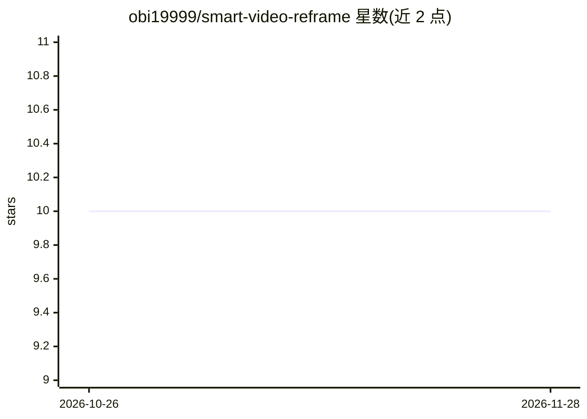

# obi19999/smart-video-reframe

⭐ 10 · Python · MIT · 推送 2026-10-13 · [GitHub](https://github.com/obi19999/smart-video-reframe) · [官网](https://obi19999.github.io) · 个人维护

**横屏视频自动转 9:16 竖屏的桌面工具：AI 人脸追踪保证构图**

面向内容创作者的视频重构图工具：读取横屏视频，用 AI 人脸检测追踪人物、分析场景，输出适配 TikTok、Reels、Shorts 的 9:16 竖屏视频，并保留原始画质。提供 Windows/macOS/Linux 安装包，图形界面操作，可调人脸检测灵敏度与场景分析参数，支持 MP4/AVI/MOV 格式。运行依赖 Python 3.7+ 与 FFmpeg，最低 4GB 内存、200MB 磁盘空间，仅支持桌面系统。

## 筛选速览

| 维度 | 判定 | 备注 |
|---|---|---|
| AI 角色 | `ai-native` | 本体是模型或模型工具 |
| 许可风险 | `permissive` | MIT |
| 部署形态 | `desktop` | 安装包/桌面程序 |
| 模型依赖 | — | README 未给出锁定关系 |
| 硬件要求 | — | 无带数字的原话,不猜 |
| 安装摩擦 | `medium` | 含编译或系统依赖之一 |
| 成熟度 | — | 结构信号不足 |

## 能力要点

- AI 人脸检测自动居中人物构图
- 场景分析按重要场景调整画面取景
- 提供 Windows/macOS/Linux 安装包与图形界面
- 支持 MP4、AVI、MOV 格式并保留原画质

## 适用场景

- 把横屏视频转成 TikTok/Reels 竖屏发布
- 批量处理访谈或多人出镜视频保持人脸居中
- 不懂剪辑技巧也能快速出竖屏短片

## 场景标签

`图像视频处理` · 领域:感知与多模态

## 证据(README 行号)

> L7: Welcome to smart-video-reframe! This tool helps you easily reframe landscape videos into the vertical format (9:16) 
> L51: - **AI-Powered Face Detection:** Automatically identifies faces to keep them centered in the frame.

## 星数曲线

2026-10-26 10 → 2026-11-28 10（+0）

---
*卡片 v1 · prompt 1.4 · 生成 2026-11-19 · 置信度 high · 依据 README sha `4ee0ac934edf` · [字段定义](../../DATASET.md)*
