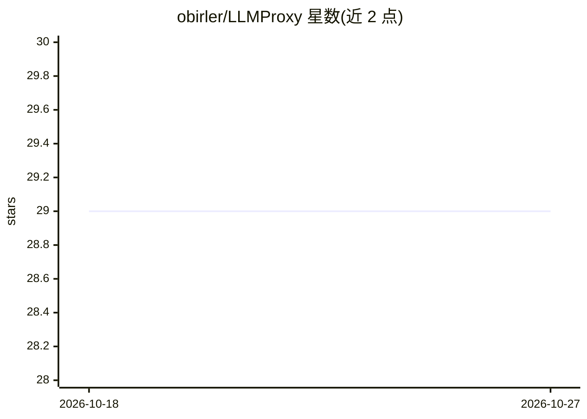

# obirler/LLMProxy

⭐ 29 · C# · MIT · 推送 2025-12-06 · [GitHub](https://github.com/obirler/LLMProxy) · 个人维护

**聚合多后端的 LLM API 路由代理与密钥管理服务**

基于 C# / ASP.NET Core 9 的自托管代理服务，位于 LLM 客户端与各 OpenAI 兼容后端（OpenAI、OpenRouter、Gemini、DeepSeek、LM Studio 等）之间。提供 OpenAI 兼容端点（chat/completions、embeddings、models），支持模型与模型组两种抽象，路由策略含 Failover、Round Robin、Weighted、Content Based 与 Mixture of Agents（多 agent 并行应答后由 orchestrator 合成）。经 Web 管理界面配置，请求日志写入本地 SQLite。需自行构建运行，Admin 端点默认无鉴权。

## 筛选速览

| 维度 | 判定 | 备注 |
|---|---|---|
| AI 角色 | `ai-ecosystem` | LLM/agent 周边工具 |
| 许可风险 | `permissive` | MIT |
| 部署形态 | `None` |  |
| 模型依赖 | — | README 未给出锁定关系 |
| 硬件要求 | — | 无带数字的原话,不猜 |
| 安装摩擦 | `medium` | 含编译或系统依赖之一 |
| 成熟度 | — | 结构信号不足 |

## 能力要点

- Mixture of Agents：并行调用多个 agent 模型并由 orchestrator 模型合成最终回答
- 模型/模型组两级路由，含 Failover、Round Robin、Weighted、正则 Content-Based 策略
- 多 API key 负载均衡与自动故障转移，流式响应透传
- 请求/响应全量日志存 SQLite 并经 Web UI 查阅

## 适用场景

- 把多个 OpenAI 兼容后端（云端与本地 LM Studio）聚合为单一端点供应用调用
- 按模型或模型组配置故障转移与负载均衡，屏蔽后端临时错误
- 用多模型 MoA 策略合成回答
- 集中管理 API key 并审计请求日志

## 场景标签

`模型网关` · 领域:Agent 开发

## 证据(README 行号)

> L10: The LLM API Proxy and Manager is a C#-based ASP.NET Core 9 application designed to serve as an intelligent and resi
> L55: * **Standard OpenAI-Compatible Endpoints:**

## 星数曲线

2026-10-18 29 → 2026-10-27 29（+0）

---
*卡片 v1 · prompt 1.4 · 生成 2026-10-26 · 置信度 high · 依据 README sha `c81a65b1624f` · [字段定义](../../DATASET.md)*
