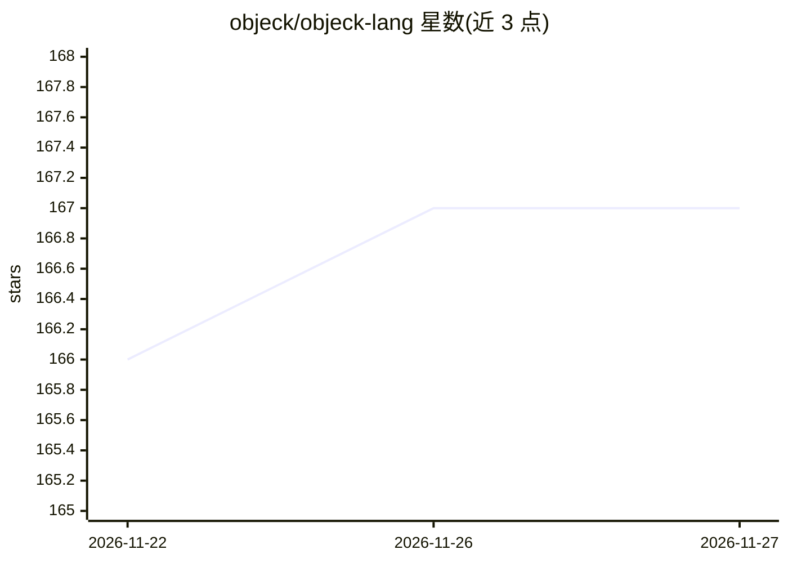

# objeck/objeck-lang

⭐ 167 · C++ · NOASSERTION · 推送 2026-11-26 · [GitHub](https://github.com/objeck/objeck-lang) · [官网](https://objeck.org) · 个人维护

**带 JIT VM 与内置 AI/LLM 库的面向对象编程语言**

Objeck 是面向对象与函数式编程语言，配 JIT 编译虚拟机，支持 ARM64/AMD64 与 Linux/macOS/Windows。标准库内置 HTTP/1.1–3、WebSocket、SQL 查询、正则、集合等模块，并自带 OpenAI、Anthropic、Gemini、Ollama 客户端及 ONNX、OpenCV、ML、NLP 库，无需第三方包。v2026.11.4 提供 provider-neutral 的 Agent 工具调用循环、MCP 服务器/客户端（函数注解 @tool 即声明工具）、RAG 组件、Actor 与遥测。提供 REPL、LSP、DAP 调试器与浏览器 Playground。旧发行版需 glibc 2.38+ 或容器运行。

## 筛选速览

| 维度 | 判定 | 备注 |
|---|---|---|
| AI 角色 | `ai-enhanced` | 去掉 AI 部分产品仍成立 |
| 许可风险 | `none` | NOASSERTION |
| 部署形态 | `desktop` | 安装包/桌面程序 |
| 模型依赖 | local-ok | 支持本地模型 |
| 硬件要求 | — | 无带数字的原话,不猜 |
| 安装摩擦 | `medium` | 含编译或系统依赖之一 |
| 成熟度 | `idea` | |

## 能力要点

- 内置 OpenAI/Anthropic/Gemini/Ollama 客户端与 ONNX、OpenCV、ML/NLP 库，无第三方包
- 函数文档注释 @tool/@resource 即声明 MCP 工具，obr --mcp 提供 stdio/HTTP 服务
- API.Agent 提供 provider-neutral 工具调用循环，支持预算、取消与追踪；OllamaBackend 支持本地模型
- 提供 42 个演示的在线 Playground、REPL、VSCode/Sublime/Kate 的 LSP 插件与 DAP 调试器

## 适用场景

- 用 Objeck 编写接入多家 LLM 的 Agent 与 MCP 工具服务
- AI/ML 原型与计算机视觉应用的快速开发
- 构建 Web 服务与实时应用
- 在本地 Ollama 模型上离线运行 Agent（数据不出机器）

## 场景标签

`RAG` `Agent 框架` · 领域:Agent 开发

## 证据(README 行号)

> L21: - 🚀 **JIT-compiled** for performance (ARM64/AMD64)
> L22: - 🤖 **AI-native**: OpenAI, Anthropic, Gemini, Ollama, ONNX, OpenCV — no third-party packages
> L26: - 🔧 **Full-featured**: Threads, generics, closures, reflection, serialization

## 星数曲线

2026-11-22 166 → 2026-11-27 167（+1）

---
*卡片 v1 · prompt 1.4 · 生成 2026-11-27 · 置信度 mid · 依据 README sha `01c37485d059` · [字段定义](../../DATASET.md)*
