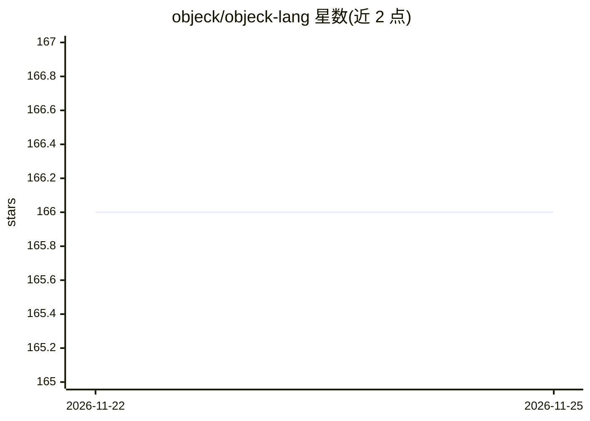

# objeck/objeck-lang

⭐ 166 · C++ · NOASSERTION · 推送 2026-11-24 · [GitHub](https://github.com/objeck/objeck-lang) · [官网](https://objeck.org) · 个人维护

**带 JIT 虚拟机的面向对象语言，内置 ML/NLP/CV/LLM 标准库**

Objeck 是一门面向对象与函数式编程语言，配套 JIT 编译的虚拟机，支持 AMD64 与 ARM64。语言运行时以单一安装包分发，标准库内置 HTTP/1.1-3、WebSocket、线程、泛型、反射等能力，并自带 ML、NLP、计算机视觉与 LLM 客户端库（OpenAI、Anthropic、Gemini、Ollama、ONNX、OpenCV），无需第三方包管理器。提供 REPL、VSCode/Sublime/Kate 的 LSP 插件、DAP 调试器与浏览器 Playground（42 个示例）。主要面向开发者做 AI/ML 原型、计算机视觉与 Web 服务等用途。

## 筛选速览

| 维度 | 判定 | 备注 |
|---|---|---|
| AI 角色 | `ai-enhanced` | 去掉 AI 部分产品仍成立 |
| 许可风险 | `none` | NOASSERTION |
| 部署形态 | `desktop` | 安装包/桌面程序 |
| 模型依赖 | local-ok | 支持本地模型 |
| 硬件要求 | — | 无带数字的原话,不猜 |
| 安装摩擦 | `medium` | 含编译或系统依赖之一 |
| 成熟度 | — | 结构信号不足 |

## 能力要点

- JIT 编译虚拟机，支持 Linux/macOS/Windows 的 x64 与 ARM64
- 标准库内置 OpenAI/Anthropic/Gemini/Ollama 客户端与 ONNX、OpenCV 接入
- LSP 插件、DAP 调试器、REPL 与无需安装的在线 Playground
- 内置 CNN 训练、LDA 主题建模、TF-IDF、统计与绘图库

## 适用场景

- 用一门语言快速做 AI/ML 原型而不引入第三方包
- 编写内置 HTTP 服务器与网络协议的 Web 服务
- 训练卷积网络或做文本分类与主题建模
- 游戏开发中的博弈搜索（Minimax/MCTS）

## 场景标签

 · 领域:编程语言/开发工具

## 证据(README 行号)

> L1: Object-oriented • JIT-compiled • AI-native • Robust APIs
> L22: - 🤖 **AI-native**: OpenAI, Anthropic, Gemini, Ollama, ONNX, OpenCV — no third-party packages
> L29: AI/ML prototyping • Computer vision • Web services • Real-time applications • Game development

## 星数曲线

2026-11-22 166 → 2026-11-25 166（+0）

---
*卡片 v1 · prompt 1.4 · 生成 2026-11-22 · 置信度 high · 依据 README sha `1a608133dff8` · [字段定义](../../DATASET.md)*
