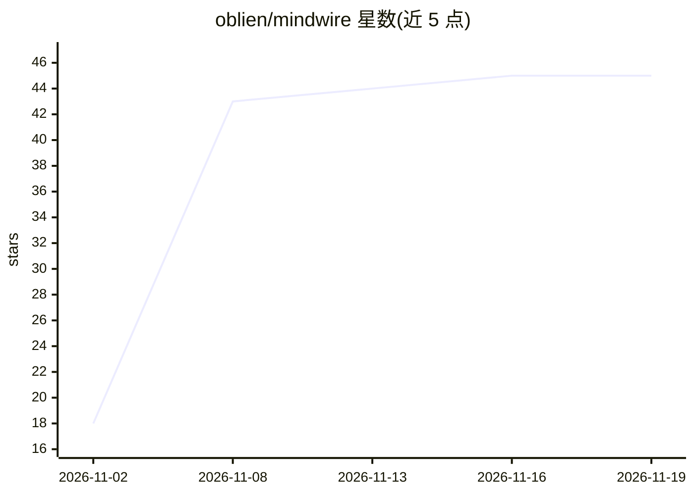

# oblien/mindwire

⭐ 45 · Swift · Apache-2.0 · 推送 2026-11-12 · [GitHub](https://github.com/oblien/mindwire) · [官网](https://mindwire.sh) · 组织维护

**给产品开发者的白标 agent harness 集成 SDK 与运行时**

面向想把 AI agent 能力嵌入自家产品的开发者：通过开源 SDK 与本地运行时接入 Codex、Claude Code、OpenCode 等 agent harness，复用其推理、规划、工具调用与执行能力。Mindwire 处理连接、会话、认证与事件翻译，支持通过 MCP 接入产品工具，并注入上下文、指令与目标；可在自有基础设施上运行，流式输出进度。提供 npm 安装，支持 Node.js/Bun 运行；Mindwire Cloud 为可选托管，非必需。运行时与 SDK 为 Apache-2.0，Apple 应用为 source-available。

## 筛选速览

| 维度 | 判定 | 备注 |
|---|---|---|
| AI 角色 | `ai-ecosystem` | LLM/agent 周边工具 |
| 许可风险 | `permissive` | Apache-2.0 |
| 部署形态 | `library` | 以包/库形式分发 |
| 模型依赖 | — | README 未给出锁定关系 |
| 硬件要求 | — | 无带数字的原话,不猜 |
| 安装摩擦 | `low` | 无编译、无系统依赖或容器化 |
| 成熟度 | — | 结构信号不足 |

## 能力要点

- 白标接入 Codex、Claude Code、OpenCode 等 agent harness
- 统一处理连接、会话、认证与事件翻译
- 通过 MCP 接入产品工具，注入上下文/指令/技能/目标
- 支持在自有基础设施运行并流式输出进度

## 适用场景

- 在自己的产品界面内提供品牌化的 agent 体验
- 把现有 agent harness 的工具调用能力接入自家产品
- 在产品内让用户通过对话创建内容或执行任务

## 场景标签

`Agent 框架` · 领域:Agent 开发

## 证据(README 行号)

> L6: Mindwire lets you **white-label and customize leading agent harnesses** like Codex,
> L7: Claude Code, and OpenCode through an open-source SDK and runtime.
> L19:  Mindwire handles connections, sessions, authentication, and event translation.

## 星数曲线

2026-11-02 18 → 2026-11-19 45（+27）

---
*卡片 v1 · prompt 1.4 · 生成 2026-11-18 · 置信度 high · 依据 README sha `0d4661981aa4` · [字段定义](../../DATASET.md)*
