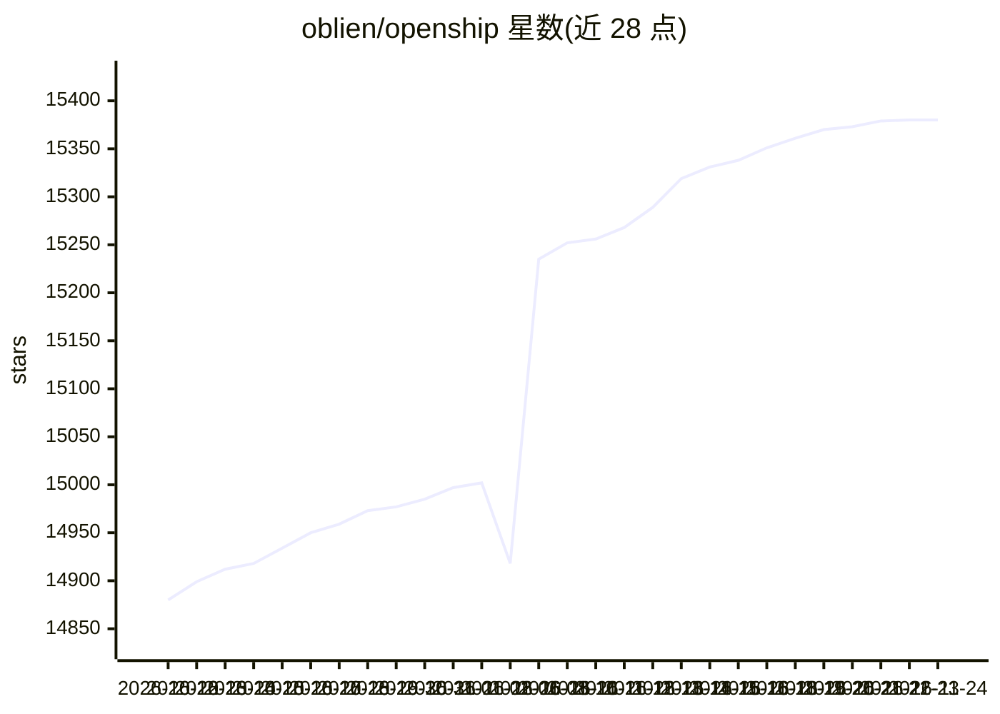

# oblien/openship

⭐ 15,385 · TypeScript · Apache-2.0 · 推送 2026-11-23 · [GitHub](https://github.com/oblien/openship) · [官网](https://openship.io) · 组织维护 · 中文 README

**自托管部署平台：从仓库到构建、路由、TLS 一条流水线**

面向代码仓库的自托管部署平台，内置 CI/CD：读取仓库的 package.json、框架配置与锁文件自动识别技术栈，构建为 Docker 镜像或裸进程发布，由 OpenResty 边缘做反向代理与 Let's Encrypt 证书签发，支持 GitHub webhook 推送即部署与单体仓库增量重建。提供桌面应用、Web 控制台、CLI、JS/TS SDK 四种接口，并暴露 MCP 端点与 REST API 供自动化与 AI agent 调用。数据库、域名、SSL、CDN、邮件、备份在同一处管理；Compose 模式仅限 Linux，其余环境运行 bare 模式。

## 筛选速览

| 维度 | 判定 | 备注 |
|---|---|---|
| AI 角色 | `ai-enhanced` | 去掉 AI 部分产品仍成立 |
| 许可风险 | `permissive` | Apache-2.0 |
| 部署形态 | `desktop` | 安装包/桌面程序 |
| 模型依赖 | — | README 未给出锁定关系 |
| 硬件要求 | — | 无带数字的原话,不猜 |
| 安装摩擦 | `low` | 无编译、无系统依赖或容器化 |
| 成熟度 | — | 结构信号不足 |

## 动量与使用信号

- 维护:`active` — 距上次 push 0.7 天,年发版 28,86 位贡献者
- 涨星:近 1 天 **+18**(自 20261016 起算)
- 安装:npm 包 `openship` 月下载 1,777
- 平台:WINDOWS / MACOS / LINUX · 协议:MCP

## 能力要点

- 仓库零配置自动识别技术栈，构建配置冻结为快照以支持可复现回滚
- OpenResty 边缘自动写入 vhost 并签发 Let's Encrypt 证书（HTTP-01）
- GitHub webhook 推送即部署，仅重建单体仓库中被改动的服务
- MCP 端点面向 AI agent，仅暴露显式加入的路由且每次调用重查权限

## 适用场景

- 把 GitHub 仓库一键部署到自己的 VPS 并自动配域名与 HTTPS
- 为团队搭建带预览环境与回滚的推送即部署流程
- 通过 MCP 端点让 AI agent 代为部署与管理应用

## 场景标签

 · 领域:开发运维/部署平台

## 证据(README 行号)

> L3:  Open-source, self-hostable deployment platform with built-in CI/CD.
> L83: - **On Linux with Docker → Compose mode** (the default). Brings up the full stack — Postgres, Redis, API, dashboard
> L174: An **MCP** endpoint (for AI agents) and a **REST API** round it out for automation. Only routes that opt in are ex

## 星数曲线

2026-10-22 14,880 → 2026-11-24 15,380（+500）

---
*卡片 v1 · prompt 1.4 · 生成 2026-11-22 · 置信度 high · 依据 README sha `2520b6267ec4` · [字段定义](../../DATASET.md)*
