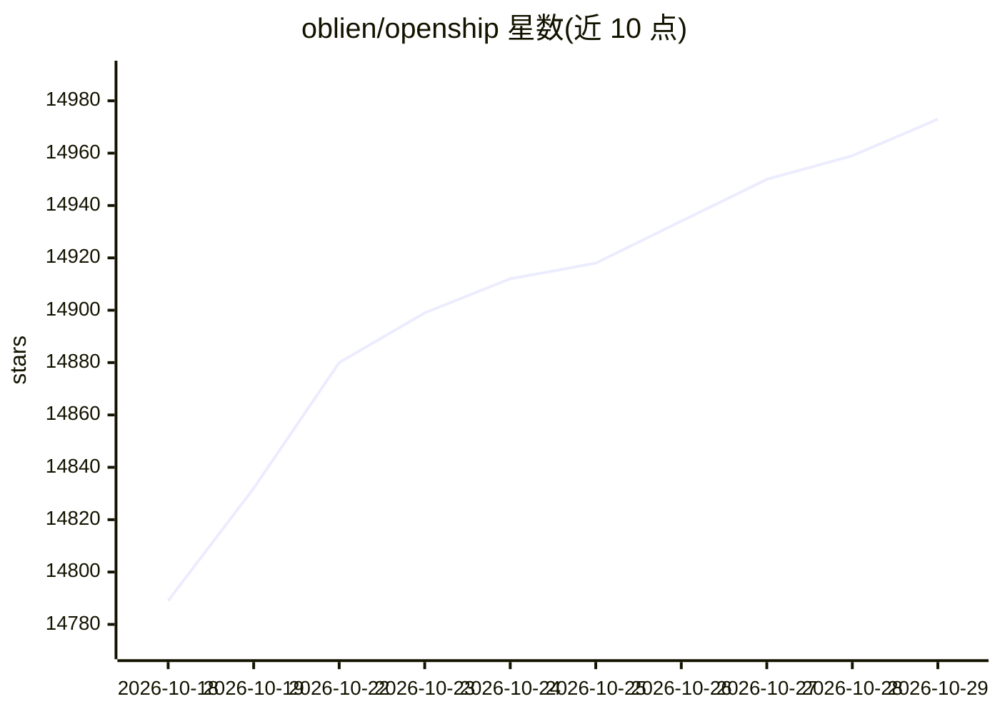

# oblien/openship

⭐ 14,973 · TypeScript · Apache-2.0 · 推送 2026-10-28 · [GitHub](https://github.com/oblien/openship) · [官网](https://openship.io) · 组织维护

**给开发者的自托管部署平台：从仓库到带 TLS 的线上应用**

自托管部署平台，内置 CI/CD：指向一个 GitHub 仓库、本地目录或预构建产物后，执行检测栈、构建（Docker 镜像或裸发布）、以容器或受管进程运行、由 OpenResty 边缘写反向代理并签发 Let's Encrypt 证书的完整流水线，支持 GitHub webhook 推送部署与单体仓库增量重建。提供桌面应用、Web 面板、CLI、JS/TS SDK 四种接口，另暴露 MCP 端点供 AI agent 调用（仅显式开放的路由成为工具，每次调用重查权限）。运行形态分桌面本机、Compose 模式（Linux+Docker）与 bare 模式；多节点与负载均衡 UI 尚在计划中。

## 筛选速览

| 维度 | 判定 | 备注 |
|---|---|---|
| AI 角色 | `ai-ecosystem` | LLM/agent 周边工具 |
| 许可风险 | `permissive` | Apache-2.0 |
| 部署形态 | `desktop` | 安装包/桌面程序 |
| 模型依赖 | — | README 未给出锁定关系 |
| 硬件要求 | — | 无带数字的原话,不猜 |
| 安装摩擦 | `low` | 无编译、无系统依赖或容器化 |
| 成熟度 | — | 结构信号不足 |

## 动量与使用信号

- 维护:`active` — 距上次 push 0.7 天,年发版 28,86 位贡献者
- 涨星:近 1 天 **+18**(自 20261016 起算)
- 安装:npm 包 `openship` 月下载 1,777
- 平台:WINDOWS / MACOS / LINUX · 协议:MCP

## 能力要点

- 从仓库检测到反向代理 + Let's Encrypt 证书的一体化部署流水线
- 桌面应用 / Web 面板 / CLI / JS/TS SDK 四种操作接口
- MCP 端点供 AI agent 调用，权限路由显式开放、逐次校验
- 内置 CI/CD、数据库/域名/SSL/CDN/邮件/备份统一管理

## 适用场景

- 把 GitHub 仓库推送后自动构建部署到自己的 VPS
- 在单台机器上管理应用域名、TLS、数据库与备份
- 在 CI 中用 CLI 或 SDK 脚本化部署
- 让 AI agent 通过 MCP 端点执行部署操作

## 场景标签

 · 领域:开发者工具/部署平台

## 证据(README 行号)

> L3:  Open-source, self-hostable deployment platform with built-in CI/CD.
> L170: An **MCP** endpoint (for AI agents) and a **REST API** round it out for automation. Only routes that opt in are ex

## 星数曲线

2026-10-18 14,789 → 2026-10-29 14,973（+184）

---
*卡片 v1 · prompt 1.4 · 生成 2026-10-18 · 置信度 high · 依据 README sha `ff1d2b6dce69` · [字段定义](../../DATASET.md)*
