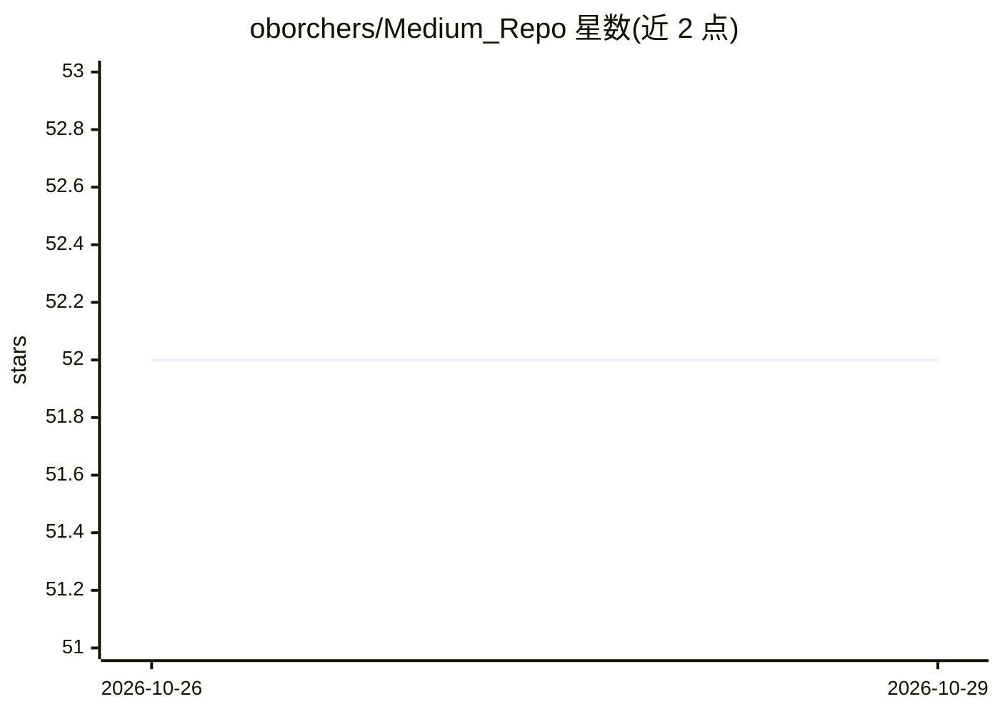

# oborchers/Medium_Repo

⭐ 52 · Jupyter Notebook · GPL-3.0 · 推送 2026-10-25 · [GitHub](https://github.com/oborchers/Medium_Repo) · [官网](https://medium.com/@oliverbor) · 个人维护

**Medium 博文配套代码示例集（深度学习/数据科学）**

个人作者将其 Medium 文章对应的代码示例按文件夹组织的仓库，每篇博文（如 Mixture Density Networks 指南、10 万条 Amazon 商品可视化、GPT-Neo 经 ONNX 部署、ONNX Runtime 与 TensorRT 性能问题复现）对应一个目录。内容以 notebook 为主，覆盖神经网络、NLP、数据可视化与商业分析等主题。作者为 IU Group 的 AI 工程负责人，现期文章见其个人网站 drborchers.com，许可见仓库 LICENSE 文件。README 未给出安装或运行说明。

## 筛选速览

| 维度 | 判定 | 备注 |
|---|---|---|
| AI 角色 | `ai-knowledge` | 知识聚合/清单类 |
| 许可风险 | `viral` | GPL-3.0 |
| 部署形态 | `None` |  |
| 模型依赖 | — | README 未给出锁定关系 |
| 硬件要求 | — | 无带数字的原话,不猜 |
| 安装摩擦 | `low` | 无编译、无系统依赖或容器化 |
| 成熟度 | — | 结构信号不足 |

## 能力要点

- 博文与代码目录一一对应
- 包含 ONNX Runtime / TensorRT 性能问题复现 notebook
- 主题覆盖神经网络、NLP、数据可视化

## 适用场景

- 阅读博文时对照运行代码示例
- 参考 ONNX 部署与推理性能问题的复现方法

## 场景标签

`教程课程` · 领域:学习与行业

## 证据(README 行号)

> L3: Code examples for my articles on Medium.
> L5: |Folder|Article|

## 星数曲线

2026-10-26 52 → 2026-10-29 52（+0）

---
*卡片 v1 · prompt 1.4 · 生成 2026-10-27 · 置信度 high · 依据 README sha `201dd25bc5a2` · [字段定义](../../DATASET.md)*
