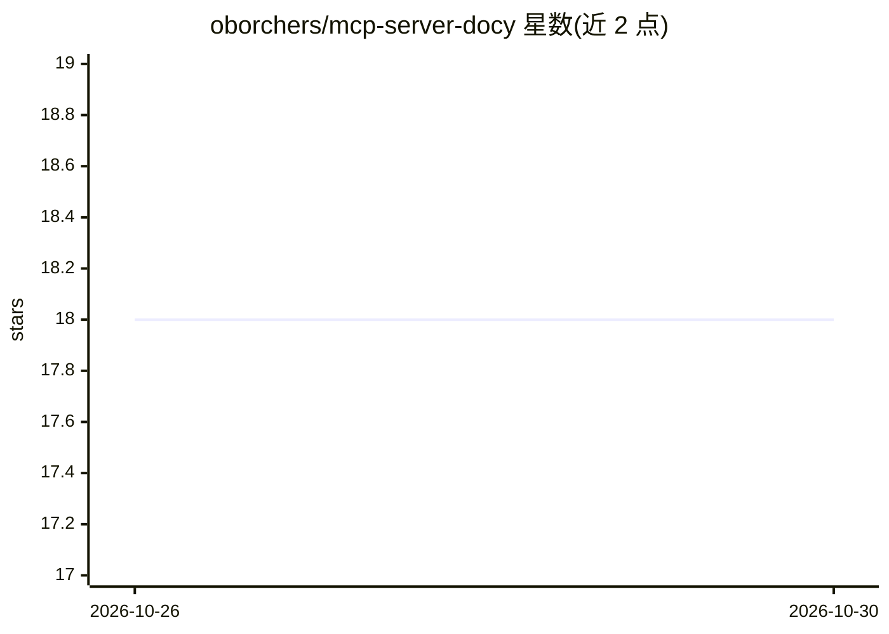

# oborchers/mcp-server-docy

⭐ 18 · Python · MIT · 推送 2026-10-25 · [GitHub](https://github.com/oborchers/mcp-server-docy) · [官网](https://www.drborchers.com) · 个人维护

**让 LLM 通过 MCP 检索技术文档站点的文档访问服务器**

基于 FastMCP v2 构建的 Model Context Protocol 服务器，通过 crawl4ai 抓取文档网站，向 LLM 提供三个工具（列出文档源、按 URL 取页面内容为 markdown、取页面链接）与对应 Prompt。文档源经环境变量或 .docy.urls 文件配置，支持运行中热重载；采用 diskcache 持久化缓存（TTL 可配）。提供 pip、uvx、Docker 三种安装方式，支持 stdio 与 SSE 传输，可配置接入 Claude、VS Code 等 MCP 客户端。限制：Claude 可能默认使用内置 WebFetchTool，需在提示中显式指定。

## 筛选速览

| 维度 | 判定 | 备注 |
|---|---|---|
| AI 角色 | `ai-ecosystem` | LLM/agent 周边工具 |
| 许可风险 | `permissive` | MIT |
| 部署形态 | `self-host` | docker 或自建部署 |
| 模型依赖 | — | README 未给出锁定关系 |
| 硬件要求 | — | 无带数字的原话,不猜 |
| 安装摩擦 | `low` | 无编译、无系统依赖或容器化 |
| 成熟度 | — | 结构信号不足 |

## 能力要点

- 提供 list_documentation_sources/fetch_documentation_page/fetch_document_links 三个 MCP 工具
- 文档源经 .docy.urls 文件配置并支持运行中热重载
- 基于 diskcache 的磁盘持久化缓存（TTL 默认 432000 秒）
- 支持 stdio 与 SSE 传输，可作为多项目共享的持久服务器

## 适用场景

- 让 Claude/VS Code 等 MCP 客户端直接查询最新技术文档
- 团队通过共享 SSE 服务器统一管理文档源与缓存
- 把项目依赖的文档 URL 存入版本控制供协作使用

## 场景标签

`网页抓取` · 领域:效率与自动化

## 证据(README 行号)

> L21: A Model Context Protocol server that provides documentation access capabilities. This server enables LLMs to search
> L50: - `list_documentation_sources_tool` - List all available documentation sources

## 星数曲线

2026-10-26 18 → 2026-10-30 18（+0）

---
*卡片 v1 · prompt 1.4 · 生成 2026-10-29 · 置信度 mid · 依据 README sha `2baf931aa4da` · [字段定义](../../DATASET.md)*
