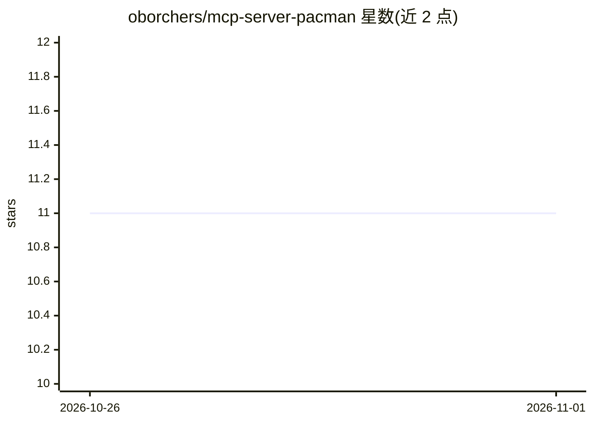

# oborchers/mcp-server-pacman

⭐ 11 · Python · MIT · 推送 2026-10-25 · [GitHub](https://github.com/oborchers/mcp-server-pacman) · [官网](https://www.drborchers.com) · 个人维护

**供 LLM 查询软件包索引的 MCP 服务器**

一个 Model Context Protocol（MCP）服务器，向 LLM 提供软件包索引查询能力：通过 search_package、package_info、search_docker_image、terraform_module_latest_version 等工具与系列 Prompt，检索 PyPI、npm、crates.io、Docker Hub 与 Terraform Registry 中的包信息、版本与镜像详情。面向在 Claude.app 或 VS Code 等客户端接入 MCP 的开发者。支持 uvx 直接运行、pip 安装与 Docker 镜像三种部署方式，可自定义 user-agent，使用 MIT 许可证。

## 筛选速览

| 维度 | 判定 | 备注 |
|---|---|---|
| AI 角色 | `ai-ecosystem` | LLM/agent 周边工具 |
| 许可风险 | `permissive` | MIT |
| 部署形态 | `self-host` | docker 或自建部署 |
| 模型依赖 | — | README 未给出锁定关系 |
| 硬件要求 | — | 无带数字的原话,不猜 |
| 安装摩擦 | `low` | 无编译、无系统依赖或容器化 |
| 成熟度 | — | 结构信号不足 |

## 能力要点

- 提供 5 个工具检索 PyPI/npm/crates/Terraform/Docker Hub
- 12 个预置 Prompt 覆盖各索引的搜索与详情查询
- 支持 uvx、pip 与 Docker 三种运行方式

## 适用场景

- 让 Claude 或 VS Code 中的 LLM 查询包版本与依赖信息
- 在编码助手工作流中搜索候选软件包
- 查询 Docker 镜像与 Terraform 模块详情

## 场景标签

 · 领域:开发工具/MCP

## 证据(README 行号)

> L5: A Model Context Protocol server that provides package index querying capabilities. This server enables LLMs to searc
> L13: - `search_package` - Search for packages in package indices

## 星数曲线

2026-10-26 11 → 2026-11-01 11（+0）

---
*卡片 v1 · prompt 1.4 · 生成 2026-11-01 · 置信度 mid · 依据 README sha `ddfe25fdc194` · [字段定义](../../DATASET.md)*
