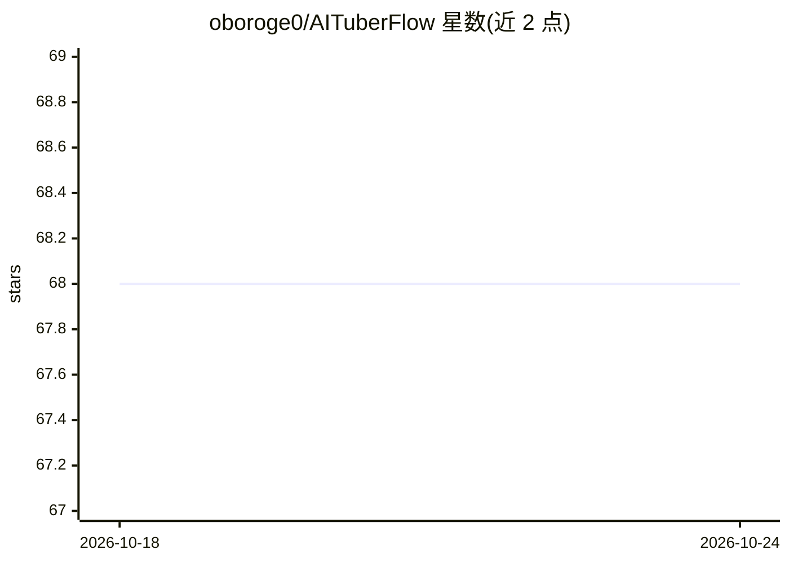

# oboroge0/AITuberFlow

⭐ 68 · TypeScript · MIT · 推送 2026-10-24 · [GitHub](https://github.com/oboroge0/AITuberFlow) · 个人维护 · 中文 README

**无代码可视化搭建 AI 虚拟主播工作流的编辑器**

面向 AITuber 创作者的桌面应用（Tauri v2，macOS/Windows）与 Web 编辑器：拖拽节点连线构建 AI 虚拟主播流水线，无需写代码。节点覆盖 LLM（OpenAI/Claude/Gemini/Ollama）、TTS（VOICEVOX/COEIROINK/Style-Bert-VITS2）、VRM 头像渲染与口型/表情控制、直播弹幕输入（YouTube/Twitch/Discord）、OBS 场景与源控制及字幕叠加。提供插件 SDK、工作流导入导出（自动排除 API key）、无 API key 的演示模式；README 声明处于快速迭代开发中。

## 筛选速览

| 维度 | 判定 | 备注 |
|---|---|---|
| AI 角色 | `ai-ecosystem` | LLM/agent 周边工具 |
| 许可风险 | `permissive` | MIT |
| 部署形态 | `self-host` | docker 或自建部署 |
| 模型依赖 | local-ok | 支持本地模型 |
| 硬件要求 | — | 无带数字的原话,不猜 |
| 安装摩擦 | `low` | 无编译、无系统依赖或容器化 |
| 成熟度 | `idea` | |

## 能力要点

- 节点式工作流：LLM/TTS/头像/输入/输出/OBS 共 30 余种节点
- 多 LLM 支持：OpenAI、Anthropic Claude、Google Gemini、Ollama（本地）
- VRM 头像显示、口型同步、基于文本情感分析的表情控制
- 插件系统与自研节点 SDK，工作流 JSON 导入导出自动排除 API key

## 适用场景

- 不写代码搭建自己的 AI 虚拟主播直播流水线
- 让 AI 角色读取直播弹幕并语音回应
- 通过 OBS 浏览器源叠加字幕、切换场景联动工作流

## 场景标签

`工作流自动化` `语音合成` · 领域:效率与自动化

## 证据(README 行号)

> L21: AITuberFlowは、AIを活用したバーチャル配信者（AITuber）のパイプラインを視覚的に構築できるツールです。ノードをドラッグ＆ドロップで配置し、接続するだけで、コードを書かずにAIキャラクターを作成できます。
> L29: - **複数LLM対応** - OpenAI, Anthropic Claude, Google Gemini, Ollama
> L150: ### LLMノード

## 星数曲线

2026-10-18 68 → 2026-10-24 68（+0）

---
*卡片 v1 · prompt 1.4 · 生成 2026-10-24 · 置信度 high · 依据 README sha `e7e9923da73d` · [字段定义](../../DATASET.md)*
