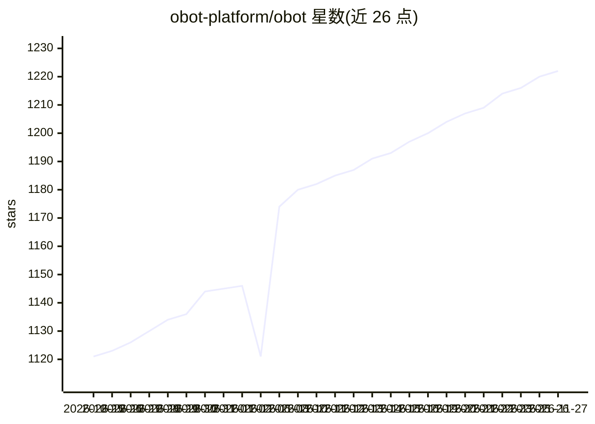

# obot-platform/obot

⭐ 1,222 · Go · MIT · 推送 2026-11-25 · [GitHub](https://github.com/obot-platform/obot) · [官网](https://obot.ai) · 组织维护

**面向组织的开源 AI 治理平台：管理 MCP 服务器、模型网关与审计**

Obot Platform 为组织提供连接 AI 客户端到模型与工具的共享基础设施，功能覆盖 MCP Gateway（以 vMCP 聚合与管控 MCP 服务器访问）、LLM Gateway（代理 OpenAI/Anthropic/Bedrock 等提供商并保管凭证）、隔离托管的 MCP 服务器、Claude Environments 会话、Git 目录驱动的 MCP 与 Skills 注册表、CLI 与技能、终端设备侧的 Obot Sentry，以及身份访问控制与关联审计日志。需 Docker 或 Kubernetes 部署，支持外部 PostgreSQL；Community 与 Enterprise 版本运行同一开源镜像，仅许可证不同。

## 筛选速览

| 维度 | 判定 | 备注 |
|---|---|---|
| AI 角色 | `ai-ecosystem` | LLM/agent 周边工具 |
| 许可风险 | `permissive` | MIT |
| 部署形态 | `self-host` | docker 或自建部署 |
| 模型依赖 | — | README 未给出锁定关系 |
| 硬件要求 | — | 无带数字的原话,不猜 |
| 安装摩擦 | `low` | 无编译、无系统依赖或容器化 |
| 成熟度 | — | 结构信号不足 |

## 能力要点

- MCP Gateway 通过 vMCP、tunnel 与过滤器统一管控 MCP 访问
- LLM Gateway 提供 OpenAI/Anthropic/Bedrock/Azure 兼容端点并记录用量与成本
- 基于 Git 目录的 MCP 与 Skills 注册表，暴露标准 MCP Registry API
- Obot Sentry 对设备上的 AI 活动做清单、审计与工具调用允许名单

## 适用场景

- 为企业内部 AI 客户端统一分发经过审批的 MCP 服务器与技能
- 集中保管模型提供商凭证并按用户限制可调用模型
- 对平台内 MCP/LLM 活动做关联审计与 token 花费追踪
- 在自有 Kubernetes 上托管 Claude 云会话并控制其可访问范围

## 场景标签

`模型网关` · 领域:Agent 开发

## 证据(README 行号)

> L3: Obot is an open-source platform for organizations to manage, secure, and govern their AI ecosystems. It provides sha
> L17: - MCP and LLM gateways for controlled access to MCP servers and model providers.

## 星数曲线

2026-10-25 1,121 → 2026-11-27 1,222（+101）

---
*卡片 v1 · prompt 1.4 · 生成 2026-11-26 · 置信度 high · 依据 README sha `4b0fd1973c8d` · [字段定义](../../DATASET.md)*
