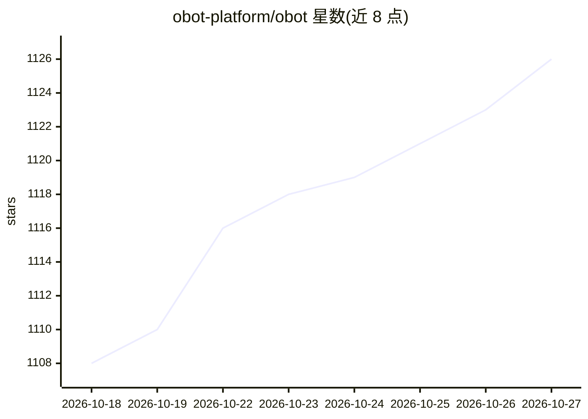

# obot-platform/obot

⭐ 1,126 · Go · MIT · 推送 2026-10-26 · [GitHub](https://github.com/obot-platform/obot) · [官网](https://obot.ai) · 组织维护

**面向组织的企业级 AI 治理平台：统一接入、管控与审计 AI 生态**

开源平台，为组织提供管理、保护与治理 AI 生态的共享基础设施：通过 MCP Gateway 与 LLM Gateway 统一代理 MCP 服务器和模型提供商（OpenAI/Anthropic/Bedrock/Azure 等），集中管理凭证与模型访问策略；提供 MCP 与技能注册表、沙箱化托管执行（Docker/K8s）、设备端 Obot Sentry 审计，以及跨服务器、模型与设备的关联审计日志。不要求统一客户端，Claude Code、Codex、Cursor、VS Code 等工具可按需接入。Docker 单容器用于开发评估，生产需 Kubernetes 部署。MIT 许可。

## 筛选速览

| 维度 | 判定 | 备注 |
|---|---|---|
| AI 角色 | `ai-ecosystem` | LLM/agent 周边工具 |
| 许可风险 | `permissive` | MIT |
| 部署形态 | `self-host` | docker 或自建部署 |
| 模型依赖 | locked-api |  |
| 硬件要求 | — | 无带数字的原话,不猜 |
| 安装摩擦 | `low` | 无编译、无系统依赖或容器化 |
| 成熟度 | — | 结构信号不足 |

## 能力要点

- MCP Gateway 统一治理入口：代理、组合、过滤 MCP 服务器与工具访问
- LLM Gateway 提供 provider 兼容端点，集中凭证与模型访问策略
- 设备端 Obot Sentry 采集本地 AI 客户端活动并执行策略（beta）
- 跨 MCP、LLM、托管工作负载与设备的关联审计日志与导出

## 适用场景

- 企业统一管控员工 AI 客户端对 MCP 服务器与模型的访问
- 集中分发与审批 MCP 服务器和 Agent 技能
- 记录并审计组织内 AI 使用活动与成本

## 场景标签

`模型网关` · 领域:Agent 开发

## 证据(README 行号)

> L3: Obot is an open-source platform for organizations to manage, secure, and govern their AI ecosystems. It provides sha
> L39: The LLM Gateway presents provider-compatible endpoints that AI clients use to reach approved models.

## 星数曲线

2026-10-18 1,108 → 2026-10-27 1,126（+18）

---
*卡片 v1 · prompt 1.4 · 生成 2026-10-21 · 置信度 high · 依据 README sha `6e2002d39fcc` · [字段定义](../../DATASET.md)*
