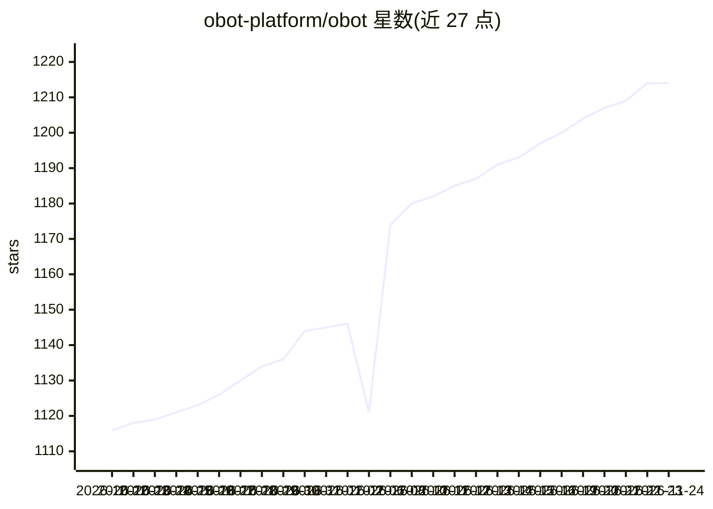

# obot-platform/obot

⭐ 1,214 · Go · MIT · 推送 2026-11-20 · [GitHub](https://github.com/obot-platform/obot) · [官网](https://obot.ai) · 组织维护

**给企业管理、安全管控其 AI 生态的开源平台**

Obot 为组织提供连接 AI 客户端与模型、工具的共享基础设施：通过 MCP Gateway 与 LLM Gateway 提供受控访问，托管隔离运行的 MCP 服务器，分发经审批的 MCP 服务器与技能注册表，管理用户身份、凭证与访问策略，并跨托管服务与用户设备（Obot Sentry）记录审计日志。不要求组织统一使用单一客户端、模型提供方或工具生态，桌面代理（Claude Code、Cursor 等）可按需接入。MIT 许可，含 Community 与 Enterprise 版本区分。

## 筛选速览

| 维度 | 判定 | 备注 |
|---|---|---|
| AI 角色 | `ai-ecosystem` | LLM/agent 周边工具 |
| 许可风险 | `permissive` | MIT |
| 部署形态 | `self-host` | docker 或自建部署 |
| 模型依赖 | — | README 未给出锁定关系 |
| 硬件要求 | — | 无带数字的原话,不猜 |
| 安装摩擦 | `low` | 无编译、无系统依赖或容器化 |
| 成熟度 | — | 结构信号不足 |

## 能力要点

- MCP Gateway：以 vMCP 虚拟服务器聚合多个目录服务器为单一入口
- LLM Gateway：对接 OpenAI/Anthropic/Bedrock/Azure 并记录用量与成本
- MCP 与 Skills 注册表基于 Git 管理目录，暴露标准 MCP Registry API
- Obot Sentry 扫描、审计并执行设备端 AI 活动策略

## 适用场景

- 为企业内的 AI 客户端统一分发与管控 MCP 服务器
- 集中保管模型凭证并按用户限制可调用的模型
- 记录并审计跨托管服务与员工设备的 AI 活动
- 将 Claude 云会话运行在组织自己的 Kubernetes 基础设施上

## 场景标签

`模型网关` · 领域:Agent 开发

## 证据(README 行号)

> L3: Obot is an open-source platform for organizations to manage, secure, and govern their AI ecosystems. It provides sha
> L17: - MCP and LLM gateways for controlled access to MCP servers and model providers.

## 星数曲线

2026-10-22 1,116 → 2026-11-24 1,214（+98）

---
*卡片 v1 · prompt 1.4 · 生成 2026-11-23 · 置信度 high · 依据 README sha `c8b02d19226a` · [字段定义](../../DATASET.md)*
