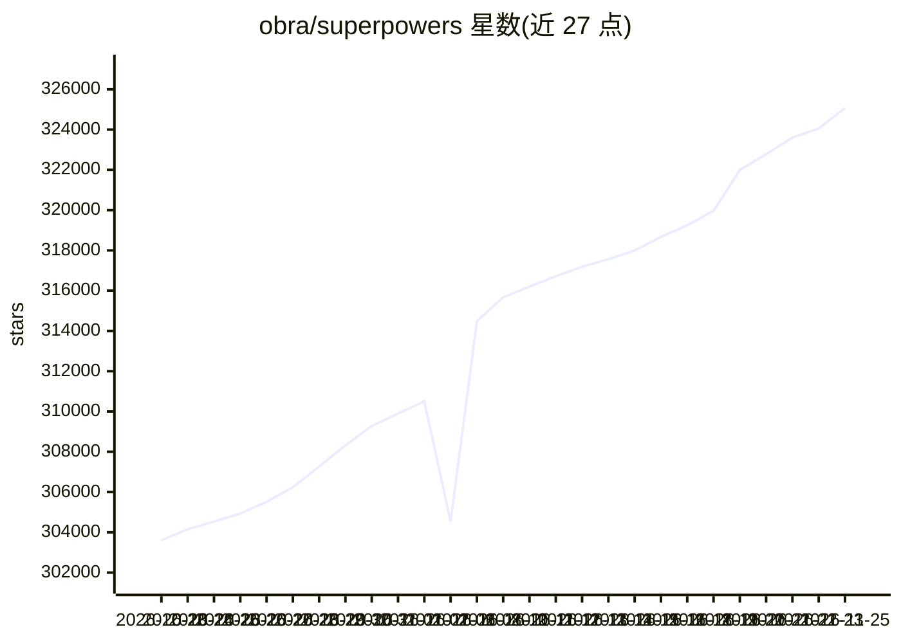

# obra/superpowers

⭐ 325,069 · Shell · MIT · 推送 2026-11-03 · [GitHub](https://github.com/obra/superpowers) · 个人维护

**为编码 Agent 安装的技能化软件开发方法论框架**

Superpowers 以可组合技能集合加初始指令的形式，为各类编码 Agent（Claude Code、Codex、Cursor、Gemini CLI 等 15+ 种宿主）提供一套开发方法论：先通过头脑风暴技能引出需求与设计文档，再生成实施计划，随后以子代理驱动流程逐任务执行，全程强制 TDD、代码评审与分支收尾。技能按阶段自动触发，提供会话诊断技能用于排查异常。各宿主分别通过插件市场或命令安装，MIT 许可。

## 筛选速览

| 维度 | 判定 | 备注 |
|---|---|---|
| AI 角色 | `ai-ecosystem` | LLM/agent 周边工具 |
| 许可风险 | `permissive` | MIT |
| 部署形态 | `None` |  |
| 模型依赖 | — | README 未给出锁定关系 |
| 硬件要求 | — | 无带数字的原话,不猜 |
| 安装摩擦 | `low` | 无编译、无系统依赖或容器化 |
| 成熟度 | — | 结构信号不足 |

## 动量与使用信号

- 维护:`active` — 距上次 push 8.2 天,年发版 15,37 位贡献者
- 涨星:近 1 天 **+926**(自 20261016 起算)

## 能力要点

- brainstorming→writing-plans→subagent-driven-development 的完整 SDLC 工作流
- 强制 RED-GREEN-REFACTOR 测试驱动开发技能
- diagnosing-superpowers 技能读取会话记录定位异常
- 支持 Claude Code、Codex、Cursor、Gemini CLI 等多种宿主的插件安装

## 适用场景

- 让编码 Agent 在写代码前先澄清需求并产出设计文档
- 以子代理方式按计划自主执行工程任务并逐项评审
- 为团队统一 TDD 与代码评审流程规范

## 场景标签

`编码 Agent` `代码审查` `Agent 框架` · 领域:Agent 开发

## 证据(README 行号)

> L3: Superpowers is a complete software development methodology for your coding agents, built on top of a set of composab
> L25: Installation differs by harness. If you use more than one, install Superpowers separately for each one.
> L295: **The agent checks for relevant skills before any task.** Mandatory workflows, not suggestions.

## 星数曲线

2026-10-23 303,603 → 2026-11-25 325,069（+21,466）

---
*卡片 v1 · prompt 1.4 · 生成 2026-11-22 · 置信度 high · 依据 README sha `31271a91514f` · [字段定义](../../DATASET.md)*
