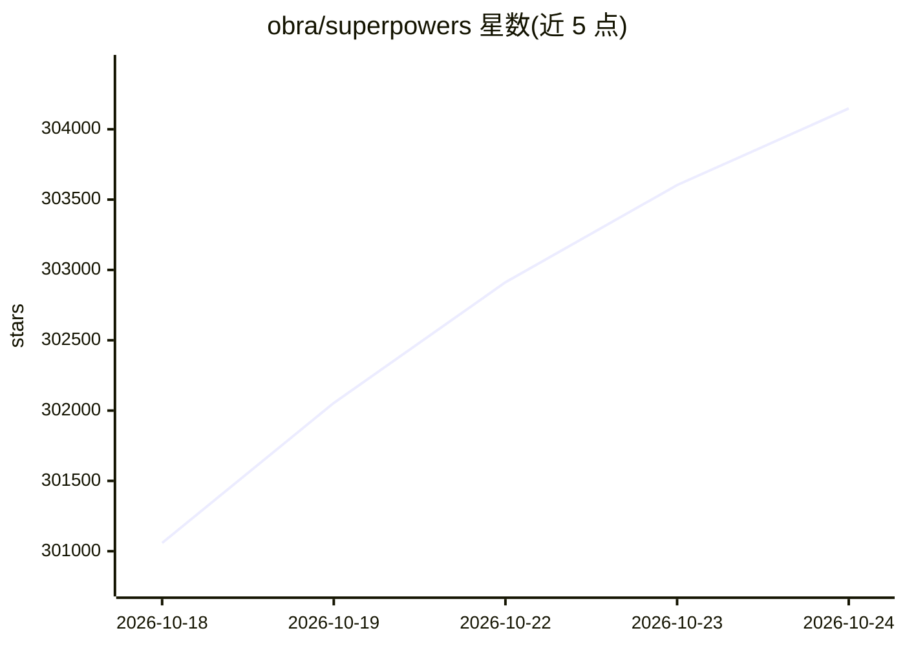

# obra/superpowers

⭐ 304,533 · Shell · MIT · 推送 2026-10-23 · [GitHub](https://github.com/obra/superpowers) · 个人维护

**给编码 agent 的技能框架与软件开发方法论**

Superpowers 是一套面向编码 agent 的软件开发方法论，由一组可组合的技能与启动指令构成。技能按阶段自动触发：先通过头脑风暴澄清需求并产出设计文档，再生成细粒度实现计划，随后以子 agent 驱动或内联方式执行任务，强制红绿 TDD、代码评审与分支收尾流程。以插件形式分发到 Claude Code、Codex、Cursor、Gemini CLI 等多种编码工具，另提供企业商业支持联系方式。

## 筛选速览

| 维度 | 判定 | 备注 |
|---|---|---|
| AI 角色 | `ai-native` | 本体是模型或模型工具 |
| 许可风险 | `permissive` | MIT |
| 部署形态 | `None` |  |
| 模型依赖 | — | README 未给出锁定关系 |
| 硬件要求 | — | 无带数字的原话,不猜 |
| 安装摩擦 | `low` | 无编译、无系统依赖或容器化 |
| 成熟度 | — | 结构信号不足 |

## 动量与使用信号

- 维护:`active` — 距上次 push 8.2 天,年发版 15,37 位贡献者
- 涨星:近 1 天 **+926**(自 20261016 起算)

## 能力要点

- 可组合技能库：测试、调试、协作、元技能四类（如 TDD、系统化调试、git worktree）
- brainstorming→计划→子 agent 执行→评审→分支收尾的七步工作流，技能自动触发
- 提供 diagnosing-superpowers 技能，读取会话记录定位流程异常
- 支持十余种编码工具的插件安装途径

## 适用场景

- 让编码 agent 在写代码前先澄清需求并产出设计文档
- 以子 agent 分派任务并附带两阶段评审的自动化开发流程
- 强制执行 TDD 与代码评审约束的团队开发
- 排查编码 agent 会话中技能未触发或偏离计划的问题

## 场景标签

`编码 Agent` `Agent 框架` · 领域:Agent 开发

## 证据(README 行号)

> L3: Superpowers is a complete software development methodology for your coding agents, built on top of a set of composab
> L15: Next up, once you say "go", it launches a *subagent-driven-development* process, having agents work through each en
> L29: Superpowers is available via the official Claude plugin marketplace

## 星数曲线

2026-10-18 301,059 → 2026-10-24 304,148（+3,089）

---
*卡片 v1 · prompt 1.4 · 生成 2026-10-18 · 置信度 high · 依据 README sha `cf104af98852` · [字段定义](../../DATASET.md)*
