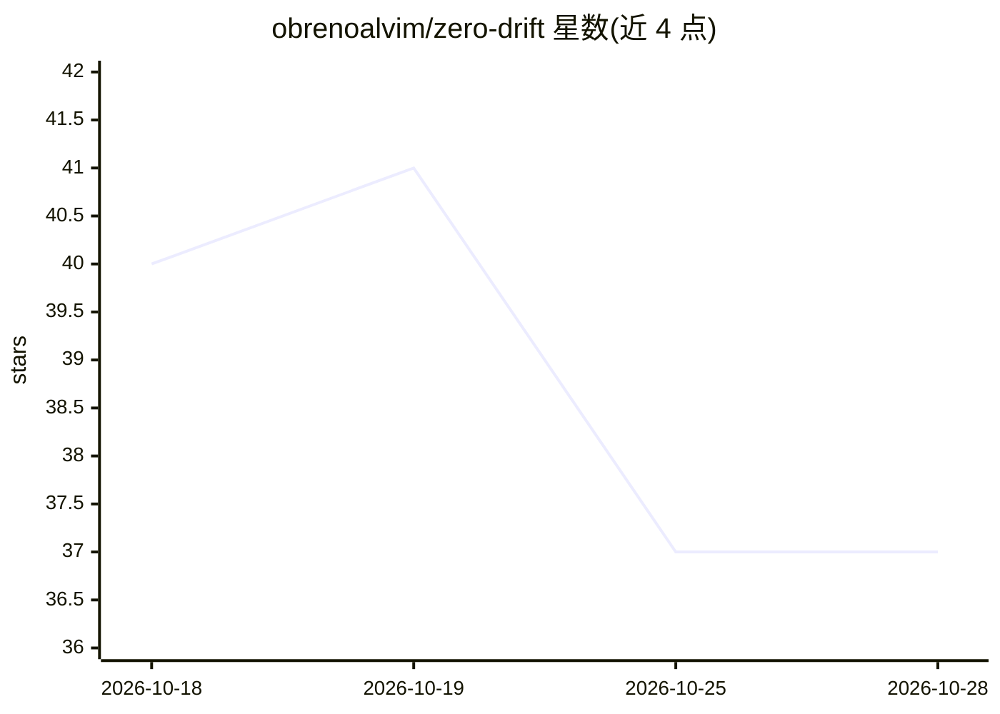

# obrenoalvim/zero-drift

⭐ 37 · JavaScript · MIT · 推送 2026-10-22 · [GitHub](https://github.com/obrenoalvim/zero-drift) · [官网](https://github.com/obrenoalvim/zero-drift) · 个人维护

**让 Claude Code 长会话保持不漂移的任务交接技能**

面向 Claude Code 的 skill/plugin：通过 SessionStart hook 在每个新会话注入两条规则——AI 回复以用户名字开头（名字异常作为会话退化的信号），以及为每个任务在项目根维护 TASK.md，只允许记录有命令与输出证据的进展，新会话读取该文件即可续接任务。要求 PATH 中有 Node.js；插件自动激活仅限 Claude Code，Cursor、Copilot、Codex 等需手动粘贴规则到 AGENTS.md/CLAUDE.md。hook 不做网络调用。

## 筛选速览

| 维度 | 判定 | 备注 |
|---|---|---|
| AI 角色 | `ai-ecosystem` | LLM/agent 周边工具 |
| 许可风险 | `permissive` | MIT |
| 部署形态 | `None` |  |
| 模型依赖 | locked-api |  |
| 硬件要求 | — | 无带数字的原话,不猜 |
| 安装摩擦 | `low` | 无编译、无系统依赖或容器化 |
| 成熟度 | — | 结构信号不足 |

## 能力要点

- SessionStart hook 自动向每个新会话注入规则
- TASK.md 以证据（命令/输出/退出码）为准记录任务状态
- 以用户名字开头的回复作为漂移检测信号
- 跨会话交接流程：新会话读取 TASK.md 续接

## 适用场景

- 长任务跨多个 Claude Code 会话时避免重复交代上下文
- 及早发现 AI 会话开始编造或遗忘决策
- 在 Cursor/Codex/Copilot 中手动套用同一套规则

## 场景标签

 · 领域:开发者工具/AI 会话管理

## 证据(README 行号)

> L5: **A Claude Code skill that keeps long AI sessions grounded.**
> L67: 1. A `SessionStart` hook (`hooks/inject.js`) reads `skills/zero-drift/SKILL.md` and adds it to the context of each 
> L75: This is the only option that turns Zero Drift on in **every** session by itself. The plugin ships a `SessionStart` 

## 星数曲线

2026-10-18 40 → 2026-10-28 37（-3）

---
*卡片 v1 · prompt 1.4 · 生成 2026-10-25 · 置信度 high · 依据 README sha `fd571e19e8ea` · [字段定义](../../DATASET.md)*
